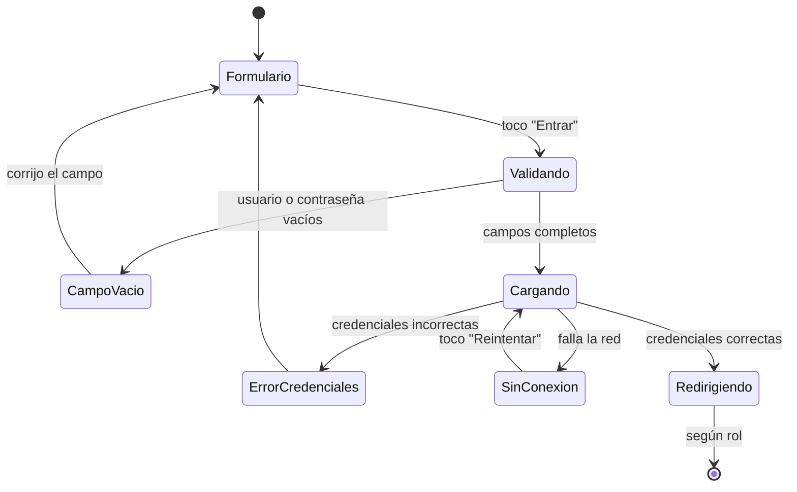
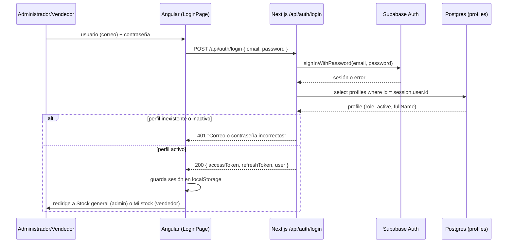
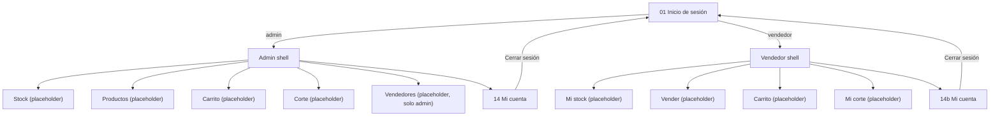

# Spec técnico — Milestone M0 · Base

> **Estado:** Implementado
> **Depende de:** Ninguno (primer milestone del proyecto)
> **Fecha:** 2026-10-23
> **Objetivo:** El administrador y el vendedor inician sesión con correo y contraseña y cada uno entra al menú de navegación de su rol, con la sesión persistida en el navegador.

Fuentes: épica `KAN-5 · M0 · Base`, historia `KAN-14 · HU-01` y páginas de Confluence "Problema y solución", "Requerimientos" y "Mockups y flujo de pantallas · MVP v1" del proyecto Jira `MammutSupplements` (no existían como `docs/*.md` locales; se leyeron directamente de Jira/Confluence con autorización del usuario). Mockups de las pantallas 01, 14/14b y el tablero de estados E01 leídos del canvas "Mammut Inventario MVP".

## 1. Objetivo y alcance

**Objetivo:** que el administrador y el vendedor inicien sesión con correo y contraseña y cada uno vea el menú de navegación correspondiente a su rol, con la sesión persistida entre recargas.

**Entra en M0 (v1):**

- Pantalla **01 Inicio de sesión** (RF-01, RF-02, RNF-04) con sus 3 estados del tablero E01: cargando, validación de campos vacíos y error de credenciales — historia `HU-01` (`KAN-14`).
- Pantalla **14 / 14b Mi cuenta**, con cierre de sesión y su diálogo de confirmación (listada en el alcance de pantallas de la épica `KAN-5`, aunque todavía no tiene una historia propia en Jira — ver Preguntas abiertas).
- Rol **administrador**: tras entrar ve "Stock general" (placeholder) y el menú inferior **Stock · Productos · Carrito · Corte · Vendedores**.
- Rol **vendedor**: tras entrar ve "Mi stock" (placeholder) y el menú inferior **Mi stock · Vender · Carrito · Mi corte**; en ninguna pantalla ve costos ni ganancia (RF-02, RNF-04).
- Extender el tipo de rol del backend reusado (`mammut-api`) para aceptar `'vendedor'` además de `'admin'` y `'client'`.
- Guard de rutas por rol, interceptor HTTP y persistencia de sesión en `localStorage` en el proyecto Angular 22.2.0 ya inicializado (scaffold vacío existente en `src/app/`).

**No entra en M0 (queda para milestones posteriores o fuera de la v1):**

- Dar de alta vendedores (RF-31) → milestone `M2 · Vendedores y entregas` (`KAN-7`). Las cuentas de vendedor para probar M0 se crean a mano (ver Plan de pruebas).
- Recuperar la propia contraseña → fuera de la v1; en la v1 la asigna el administrador.
- Cualquier funcionalidad real detrás de los ítems del menú (Stock, Productos, Carrito, Corte, Vendedores, Mi stock, Vender, Mi corte): son rutas placeholder "Próximamente" en M0; su funcionalidad real llega en `M1`–`M7` (`KAN-6` a `KAN-13`).
- El modelo de negocio que ya vive en el backend reusado (clientes en consignación, ventas directas, cortes, créditos, merma): no se toca, no se migra ni se renombra en este spec.
- Políticas RLS, triggers, Edge Functions, despliegue y CI/CD.

**Decisión (Fase 2):** el backend existente se reusa y se extiende en lugar de crear uno nuevo en paralelo; el stack real a usar es **Angular 22.2.0** (el instalado en `package.json`), no el "Angular 18" que mencionan la épica y el mockup de Confluence — confirmado por el usuario.

## 2. Reglas de negocio

Acotadas a lo que M0 (login y navegación por rol) necesita; el resto de "Problema y solución" (stock, fraccionado, cortes) no aplica a este milestone.

- **RF-01:** el login acepta administrador o vendedor con el mismo formulario; el backend decide a dónde entra cada uno según `profiles.role`.
- **RF-02 / RNF-04:** el vendedor nunca ve costos ni ganancia en ninguna pantalla. En M0 esto se traduce en que el guard y el menú del vendedor jamás exponen esas rutas, y las pantallas placeholder del vendedor no listan ese tipo de dato aunque todavía no haya datos reales.
- Solo el administrador puede llegar a la ruta "Vendedores" del menú (alta de vendedores, pantalla 15, fuera de esta historia pero el guard de esa ruta ya debe exigir rol admin).
- Un perfil con `profiles.active = false` no puede iniciar sesión ni mantener una sesión vigente, sea admin o vendedor — regla ya implementada en el backend reusado (`loadActiveProfile`, `getAuthContext`); se verifica que siga aplicando a `'vendedor'`.
- El mensaje de error de login es siempre el mismo ("Correo o contraseña incorrectos") para correo inexistente, contraseña incorrecta o perfil inactivo: no revela cuál de los tres ocurrió — regla ya implementada, se reusa sin cambios.
- **Decisión (Fase 2):** el campo "Usuario" del mockup es el correo electrónico; no hay una resolución usuario→correo en el backend.

## 3. Diagramas

### 3.1 Estados de la pantalla 01 (tablero E01)



### 3.2 Secuencia de login



### 3.3 Navegación por rol



## 4. Endpoints

Ninguno es nuevo: los cuatro ya existen en `backend/app/api/auth/` y `backend/app/api/me/`. Este spec solo amplía el tipo de `role` que aceptan para incluir `'vendedor'`.

| Método y ruta | Archivo | Cambia en este spec |
| --- | --- | --- |
| `POST /api/auth/login` | `backend/app/api/auth/login/route.ts` | No (ya acepta cualquier `role` de `profiles`) |
| `POST /api/auth/refresh` | `backend/app/api/auth/refresh/route.ts` | No |
| `POST /api/auth/logout` | `backend/app/api/auth/logout/route.ts` | No |
| `GET /api/me` | `backend/app/api/me/route.ts` | No |

Cambia el tipo compartido `AuthContext['role']` en `backend/src/auth/context.ts` y el segundo parámetro de `createAccount` en `backend/src/accounts/accounts.ts`, de `'admin' | 'client'` a `'admin' | 'client' | 'vendedor'`.

## 5. Contratos de petición y respuesta

`AuthContext` extendido (usado por `GET /api/me` y dentro de `SessionResult`):

```ts
interface AuthContext {
  userId: string
  role: 'admin' | 'client' | 'vendedor'
  clientId: number | null // null si role = 'admin' o 'vendedor'
  fullName: string
}
```

**`POST /api/auth/login`**
- Petición: `{ "email": string, "password": string }`
- Respuesta 200: `{ accessToken: string, refreshToken: string, expiresAt: number | null, user: AuthContext }`
- Respuesta 401: `{ "error": { "code": "unauthorized", "message": "Correo o contraseña incorrectos" } }`

**`POST /api/auth/refresh`**
- Petición: `{ "refreshToken": string }`
- Respuesta 200: igual forma que `login`.
- Respuesta 401: `{ "error": { "code": "unauthorized", "message": "Sesión inválida o expirada" } }`

**`POST /api/auth/logout`**
- Petición: sin cuerpo; header `Authorization: Bearer <accessToken>`.
- Respuesta 204 sin cuerpo.

**`GET /api/me`**
- Petición: sin cuerpo; header `Authorization: Bearer <accessToken>`.
- Respuesta 200: `AuthContext`.
- Respuesta 401 si falta el token o el perfil está inactivo.

El estado "sin conexión" (criterio 5 de HU-01) no es una respuesta del backend: el cliente Angular lo detecta cuando la petición no llega a completarse (error de red, no una respuesta HTTP) y lo trata como un estado local, reusando el layout de "Error" del tablero E01 con otro texto e icono.

## 6. Componentes

**Frontend (`mamut-admin/src/app/`, todo nuevo salvo `app.routes.ts` y `app.config.ts` que ya existen vacíos):**

- `auth/interfaces/auth.models.ts` — interfaces `AuthContext` y `SessionResult`, espejo de las del backend.
- `auth/services/auth.service.ts` — `login()`, `logout()`, `refresh()`; signals `currentUser` e `isAuthenticated`; persiste `accessToken`, `refreshToken` y `user` en `localStorage` bajo las claves `mamut.accessToken`, `mamut.refreshToken` y `mamut.user`.
- `auth/services/auth.interceptor.ts` — agrega `Authorization: Bearer <accessToken>` a toda petición a la API; ante un 401 intenta `refresh()` una vez antes de forzar `logout()` y redirigir a `/login`.
- `auth/guards/role.guard.ts` — `canMatch` que exige sesión válida y el rol permitido por la ruta; sin sesión redirige a `/login`, con el rol equivocado redirige a la home de su propio rol.
- `pages/login-page/login-page.component.ts` (+ `.html`) — pantalla 01, con los 3 estados de la sección 3.1.
- `pages/account-page/account-page.component.ts` (+ `.html`) — pantalla 14/14b Mi cuenta, con el diálogo de confirmación de cierre de sesión descrito en el mockup `Cuenta.dc.html`.
- `pages/admin-page/admin-page.component.ts` (+ `.html`) — página del administrador: cabecera, `<router-outlet>` y el menú inferior.
- `pages/vendedor-page/vendedor-page.component.ts` (+ `.html`) — página del vendedor, mismo patrón.
- `pages/coming-soon-page/coming-soon-page.component.ts` (+ `.html`) — pantalla genérica "Próximamente: {título}", reusada por cada ruta placeholder del menú.
- `shared/api-base-url.ts`, `shared/initials.ts` — utilidades reusadas entre `auth/` y `pages/`.
- `app.routes.ts` — árbol de rutas: `/login`, `/cuenta`, y las rutas de `admin-page`/`vendedor-page` protegidas por `role.guard.ts`.
- `app.routes.server.ts` — `cuenta`, `admin`/`admin/**` y `vendedor`/`vendedor/**` en `RenderMode.Client` (no SSR): el guard depende de `localStorage`, que el servidor no puede ver (hallazgo del Paso 10, ver §8).

Estructura por carpeta de funcionalidad (`pages/`, `auth/`, `shared/`), no por tipo de archivo; ver `CLAUDE.md`.

**Backend (`mamut-admin/backend/src/`):**

- `auth/context.ts` — ampliar `AuthContext['role']` a `'admin' | 'client' | 'vendedor'`.
- `accounts/accounts.ts` — ampliar el tipo del segundo parámetro de `createAccount` para admitir `'vendedor'` (RF-31 no se implementa en M0, pero el tipo debe admitirlo para no romperse cuando M2 lo use).
- Migración SQL que amplíe el check `profiles_role_check` de `('admin','client')` a `('admin','client','vendedor')` — el repo donde vive esa migración es una pregunta abierta (sección 8).

## 7. Plan de pruebas

**Backend (Vitest, aún sin suite en `mamut-admin/backend`):**

- Un perfil `role = 'vendedor'` activo puede loguearse y `GET /api/me` devuelve `role: 'vendedor'`.
- Un perfil inactivo (admin o vendedor) recibe 401 al intentar loguearse.
- El mensaje de error es idéntico para correo inexistente, contraseña incorrecta y perfil inactivo.

**Frontend (`@angular/build:unit-test`, el runner ya configurado en `angular.json`):**

- `AuthService` guarda y lee la sesión de `localStorage` correctamente, y la limpia en `logout()`.
- `role.guard.ts` redirige correctamente para cada combinación de rol y ruta (admin→admin, vendedor→vendedor, sin sesión→login, rol cruzado→home propia).
- `LoginPage` muestra cada uno de los 3 estados de la sección 3.1 ante la condición correspondiente.

**Manual, contra los 5 criterios de aceptación de `HU-01` y la pantalla 14 — ejecutado el 2026-10-24 con Playwright contra `ng serve` + `next start` reales y dos cuentas de prueba en Supabase (`m0-test-admin@mammut.local`, `m0-test-vendedor@mammut.local`, borradas al terminar). Los 7 puntos pasaron:**

1. ✅ Login admin correcto → redirige a `/admin/stock` (placeholder "Próximamente: Stock" — la pantalla real "Stock general" es de M1) con el menú Stock·Productos·Carrito·Corte·Vendedores.
2. ✅ Login vendedor correcto → redirige a `/vendedor/mi-stock` con el menú Mi stock·Vender·Carrito·Mi corte; no aparece "costo" ni "ganancia" en ningún texto de la página.
3. ✅ Credenciales incorrectas → mensaje "Usuario o contraseña incorrectos", sigue en el login.
4. ✅ Campos vacíos → validación en rojo por campo, no se envía la petición.
5. ✅ Sin conexión (petición de login abortada) → aviso de sin conexión con botón "Reintentar"; al quitar el bloqueo, "Reintentar" completa el login real.
6. ✅ Mi cuenta → cerrar sesión con confirmación → vuelve al login; una llamada posterior a `/api/me` con el token anterior responde 401.
7. ✅ Recargar la página con sesión activa mantiene la sesión — **solo tras el fix de §8** (ver riesgo resuelto abajo); antes del fix, recargar `/admin/*`, `/vendedor/*` o `/cuenta` mandaba al login aunque hubiera sesión real.

**Cuentas de prueba:** como RF-31 está fuera de esta historia, se crean a mano (vía Supabase Admin API, mismo patrón que `backend/tests/helpers/users.ts`) y se borran al terminar de probar — no quedan cuentas `m0-test-*` permanentes en la base.

## 8. Riesgos y preguntas abiertas

**Riesgos:**

| Riesgo | Mitigación |
| --- | --- |
| Reusar el backend de un proyecto anterior (clientes en consignación) puede arrastrar reglas que no aplican a este proyecto | Este spec solo toca autenticación; ninguna tabla ni endpoint de `clients`/consignación se modifica aquí |
| Sin RF-31 implementado no hay una forma estándar de crear vendedores de prueba | Alta manual documentada en el Plan de pruebas |
| El tablero E01 no dibuja un estado "sin conexión" separado; se reusa el layout de "Error" con otro texto | Verificar en QA manual que el mensaje distingue claramente credenciales incorrectas de falta de conexión |
| ~~`/admin`, `/vendedor` y `/cuenta` dependen de `roleGuard`, que lee `localStorage` — el servidor SSR no la ve y evalúa el guard como "sin sesión" en cada recarga, aunque el usuario sí tenga sesión real~~ — **Encontrado y resuelto en la verificación manual del Paso 10 (2026-10-24):** `src/app/app.routes.server.ts` marca esas rutas como `RenderMode.Client` (se resuelven solo en el navegador); confirmado con Playwright real que recargar con sesión activa ya no manda al login. |

**Preguntas abiertas:**

1. ¿Dónde viven las migraciones SQL de este proyecto? El comentario de `backend/drizzle.config.ts` dice que el esquema se migra con `supabase/migrations/` "en el repo del frontend", pero esa carpeta solo existe en el repo anterior (`mammutSuplements/mammut-Suplements`). ¿`mamut-admin` tendrá su propia carpeta `supabase/migrations/`, o se sigue editando desde el repo anterior porque ambos comparten el mismo proyecto de Supabase? **Parcialmente resuelto:** el `ALTER TABLE` que amplía `profiles_role_check` a `'vendedor'` ya se aplicó contra la base real (Paso 2/Pregunta del usuario), pero como SQL suelto, no como un archivo de migración versionado — la pregunta de en qué repo debería vivir ese archivo sigue abierta.
2. Todavía no existe una historia de Jira para la pantalla 14 (Mi cuenta y cerrar sesión), aunque la épica `KAN-5` la lista como pantalla incluida en M0. ¿Se crea esa historia antes de implementar, o este spec cubre esa pantalla sin historia formal?
3. ~~El mockup de Mi cuenta muestra "Último acceso: Hoy, 9:12" como dato fijo de ejemplo~~ — **Resuelto durante la implementación (Paso 8):** se omiten en M0 tanto "Último acceso" como la fila "Usuario" (correo) del mockup — ninguno de los dos existe en `AuthContext` (§5) y no se amplía el contrato para esto. La pantalla de Mi cuenta en M0 muestra solo nombre, rol, la nota sobre contraseña y "Cerrar sesión".
4. ¿El "vendedor" de este sistema es conceptualmente el mismo actor que el "client" (distribuidor en consignación) del backend reusado, solo con otro nombre, o son dos roles genuinamente distintos que convivirán? No se decide aquí (este spec solo toca auth), pero condiciona si M1/M2 reusan `clients`/`consignment_items` para vendedores o crean tablas nuevas.
5. ~~¿Qué dominio de correo usan las cuentas de vendedor de prueba?~~ — **Resuelto en la práctica:** `@mammut.local`, usado tanto en `backend/tests/helpers/users.ts` como en las cuentas de prueba del Paso 10.

## Lo que **no** entra en este spec

- Dar de alta vendedores (RF-31): `M2 · Vendedores y entregas` (`KAN-7`).
- Cualquier funcionalidad real detrás de las rutas placeholder del menú: `M1`–`M7` (`KAN-6` a `KAN-13`).
- Cambios al modelo de negocio del backend reusado (clientes, consignación, ventas, cortes, créditos, merma).
- Migraciones de base de datos, despliegue y CI/CD.

Cada uno de estos, si se implementa, va en su propio spec.
