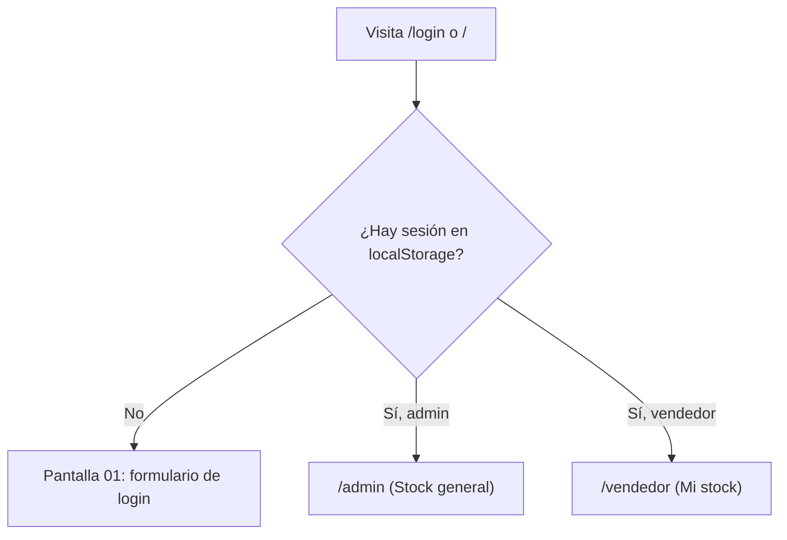

# Spec técnico — HU-03 · Cada quien entra solo a las pantallas de su rol

> **Estado:** Implementado
> **Depende de:** M0-base (`specs/M0-base/spec.md`)
> **Fecha:** 2026-10-24
> **Objetivo:** que alguien con sesión activa que reabre la app o vuelve a `/login` entre directo a la pantalla de inicio de su rol, sin escribir otra vez la contraseña, cerrando el único criterio de aceptación de HU-03 que la revisión de código encontró pendiente.

Fuentes: historia `SCRUM-17 · HU-03` (y su comentario de revisión del 24 de octubre de 2026), épica `SCRUM-5 · M0 · Base`, historias ya terminadas `SCRUM-14 · HU-01` y `SCRUM-16 · HU-02`, tarea `SCRUM-18 · T-01`, páginas de Confluence "Requerimientos" (RF-01, RF-02, RNF-04, Restricciones), "Mockups y flujo de pantallas · MVP v1" (sección 2 Roles) y "MVP" del proyecto Jira `MammutSuplements` (espacio `SCRUM`), y el spec previo `specs/M0-base/spec.md`.

## 1. Objetivo y alcance

HU-03 es una regla general (no una pantalla nueva) con 5 criterios de aceptación. La revisión de código del 24 de octubre de 2026 sobre el repo tal como quedó tras M0-base encontró:

- ✅ Criterio 1 (sin sesión, cualquier ruta lleva a Inicio de sesión) — ya cumplido por `role.guard.ts` y la ruta `**` → `/login`.
- ✅ Criterio 2 (un vendedor que escribe a mano una ruta de administrador regresa a Mi stock) — ya cumplido por `roleGuard` + `ROLE_HOME`.
- ✅ Criterio 4 (un administrador que abre una ruta de vendedor regresa a Stock general) — mismo mecanismo.
- ✅ Criterio 3 (la API nunca devuelve costo de fábrica, costo con envío ni ganancia a quien no es administrador) — no existen todavía endpoints de productos con costo (llegan en M1); los endpoints que sí existen hoy (`admins`, `clients`, `logins`) ya exigen rol admin. **Decisión de esta sesión:** se da por cubierto con el código actual, sin trabajo nuevo; se vuelve a revisar cuando M1 agregue productos con costo.
- ❌ Criterio 5 (reabrir la app con sesión activa entra directo a la pantalla del rol, sin pedir contraseña otra vez): hoy `/login` siempre muestra el formulario, sin importar si ya hay sesión guardada en `localStorage`. **Este spec existe para cerrar justo este criterio.**

**Entra en este spec:**

- Un guard nuevo (`guestGuard`) que, si ya hay sesión, redirige `/login` a la home del rol (`/admin` o `/vendedor`) en vez de mostrar el formulario.
- Aplicar ese guard a la ruta `login` en `app.routes.ts`.
- Marcar `login` como `RenderMode.Client` en `app.routes.server.ts`, por la misma razón que ya aplica a `/admin`, `/vendedor` y `/cuenta`: el guard depende de `localStorage`, que el servidor SSR no ve.
- Prueba unitaria del guard nuevo, en el mismo patrón que `role.guard.spec.ts`.

**No entra en este spec:**

- Nada del criterio 3: no se tocan endpoints del backend ni se agregan pruebas de backend. Queda documentado como ya cubierto; se vuelve a mirar en M1 cuando existan datos de costo que proteger.
- Los criterios 1, 2 y 4: ya están implementados y probados (`role.guard.spec.ts`); este spec no los modifica, solo los deja documentados como ya cumplidos.
- Cualquier funcionalidad real detrás de las rutas placeholder del menú (Stock, Productos, Carrito, Corte, Vendedores, Mi stock, Vender, Mi corte) — sigue siendo de `M1`–`M7`.
- El botón "atrás" del navegador tras cerrar sesión — es el criterio 5 de HU-02 (`SCRUM-16`), ya implementado y fuera de esta historia.

## 2. Reglas de negocio

- **Criterio 5 de HU-03:** con sesión guardada (hay un `AuthContext` en `localStorage` bajo la clave `mamut.user`), visitar `/login` o `/` nunca debe mostrar el formulario: debe redirigir de inmediato a `/admin` (rol admin) o `/vendedor` (rol vendedor).
- Sin sesión, `/login` sigue mostrando el formulario normalmente — sin cambios.
- El guard nuevo no valida el token contra el backend (no llama a `/api/me`): confía en el mismo patrón que `roleGuard`, que también solo mira el signal `currentUser()`. Si el token expiró o el perfil se desactivó, el interceptor existente lo detecta en la primera petición real a la API y fuerza `logout()` — mismo comportamiento que hoy ya tienen `/admin`, `/vendedor` y `/cuenta`.

## 3. Diagrama

## 4. Endpoints

Ninguno nuevo ni modificado. Este spec es puramente de enrutamiento en el frontend; no toca `backend/`.

## 5. Modelo de datos

Esta historia no introduce estructuras nuevas. Reusa `AuthContext` y las claves de `localStorage` (`mamut.accessToken`, `mamut.refreshToken`, `mamut.user`) ya definidas en `specs/M0-base/spec.md` §5–6.

## 6. Plan de implementación

1. Crear `src/app/auth/guards/guest.guard.ts` con `guestGuard: CanMatchFn`, simétrico a `role.guard.ts`: lee `AuthService.currentUser()`; si hay usuario, `router.createUrlTree([ROLE_HOME[user.role] ?? '/login'])`; si no, `true`. Reusa el `ROLE_HOME` ya exportado de `role.guard.ts` en vez de duplicarlo.
2. Crear `src/app/auth/guards/guest.guard.spec.ts` con el mismo patrón que `role.guard.spec.ts`: sesión de admin → redirige a `/admin`; sesión de vendedor → redirige a `/vendedor`; sin sesión → deja pasar (`true`).
3. Aplicar `canMatch: [guestGuard]` a la ruta `login` en `app.routes.ts`.
4. Agregar `{ path: 'login', renderMode: RenderMode.Client }` en `app.routes.server.ts`, antes del `**`, con un comentario que explique por qué (mismo motivo que `cuenta`/`admin`/`vendedor`, documentado en `specs/M0-base/spec.md` §8).
5. Verificación manual con `ng serve`: loguearse, recargar `/login` y `/` con la sesión activa y confirmar que entra directo a la pantalla del rol sin mostrar el formulario; cerrar sesión y confirmar que `/login` vuelve a mostrar el formulario normalmente.

## 7. Plan de pruebas

**Frontend (`@angular/build:unit-test`):**

- `guest.guard.spec.ts`: con sesión de administrador guardada, redirige a `/admin`; con sesión de vendedor, redirige a `/vendedor`; sin sesión, deja pasar (`true`).
- `role.guard.spec.ts` existente sigue en verde sin cambios (regresión de los criterios 1, 2 y 4, que no se tocan).

**Manual (sin cuentas nuevas de Supabase, reusando credenciales de prueba a mano):**

1. Con sesión activa de administrador, recargar `/login` → entra directo a `/admin/stock`, sin ver el formulario.
2. Con sesión activa de vendedor, recargar `/login` → entra directo a `/vendedor/mi-stock`.
3. Con sesión activa, visitar `/` → mismo resultado que visitar `/login` (pasa por la cadena `'' → login → guestGuard`).
4. Sin sesión (o tras cerrar sesión), visitar `/login` → sigue mostrando el formulario normalmente.

**Backend:** sin cambios. El criterio 3 queda documentado como cubierto por el código actual (ver §1 y §8); no se agrega prueba nueva.

## 8. Decisiones tomadas y descartadas

- **Sí:** guard nuevo `guestGuard` en vez de poner la lógica dentro de `LoginPageComponent`. Razón: sigue el mismo patrón que `roleGuard` (un `CanMatchFn` declarativo en `app.routes.ts`), es más fácil de probar de forma aislada y no mezcla la redirección con el estado visual del formulario.
- **No:** validar el token contra `/api/me` antes de redirigir. Razón: `roleGuard` tampoco lo hace; el interceptor ya maneja un token expirado o un perfil desactivado en la primera petición real (`specs/M0-base/spec.md` §6). Agregar esa llamada aquí sería inconsistente con el resto del guardado de rutas y retrasaría la redirección sin necesidad.
- **Sí:** mantener `'' → redirectTo: 'login'` sin tocarlo y dejar que `guestGuard` en la ruta `login` resuelva también el caso de visitar `/`. Razón: menos código que un guard separado para `''`, mismo resultado visible para quien usa la app.
- **No:** agregar una prueba de backend (Vitest) para los endpoints `admins`/`clients`/`logins` como parte de esta historia. Razón (decisión del usuario en la Fase 2 de este spec): ya exigen rol admin y todavía no hay ningún dato de costo o ganancia que proteger; se revisa de nuevo cuando M1 agregue productos con costo. El criterio 3 de `SCRUM-17` se marca como resuelto en Jira sin trabajo de código adicional.
- **No:** repetir el ciclo completo de Playwright con cuentas de prueba reales de Supabase (como en M0-base §7). Razón (decisión del usuario): para este cambio puntual basta la prueba unitaria del guard más una verificación manual rápida con `ng serve`.

## 9. Riesgos

| Riesgo | Mitigación |
| --- | --- |
| Marcar `login` como `RenderMode.Client` podría introducir el mismo parpadeo del formulario antes de redirigir que ya se documentó para `/admin`, `/vendedor` y `/cuenta` en M0-base | Mismo riesgo ya aceptado y sin mitigación adicional en M0-base; se verifica visualmente en el paso 5 del plan de implementación y, si molesta, se ataca en un spec de UX aparte |
| `guestGuard` y `roleGuard` leen el mismo signal pero son dos funciones separadas: un cambio futuro en una podría no reflejarse en la otra | Ambas reusan `ROLE_HOME` desde el mismo archivo (`role.guard.ts`), así que la tabla rol→home no se duplica, solo la dirección de la redirección |

## Lo que **no** entra en este spec

- Ninguna prueba ni cambio de backend para el criterio 3 — queda marcado como ya resuelto en Jira (`SCRUM-17`); se re-abre si M1 agrega datos sensibles que hoy no existen.
- Los criterios 1, 2 y 4 de HU-03 — ya implementados y probados en M0-base; este spec no los modifica.
- Cualquier funcionalidad real detrás de las rutas placeholder del menú — `M1`–`M7`.
- El botón "atrás" tras cerrar sesión (criterio 5 de HU-02) — ya resuelto en `SCRUM-16`.

Cada uno de estos, si se retoma, va en su propio spec.
