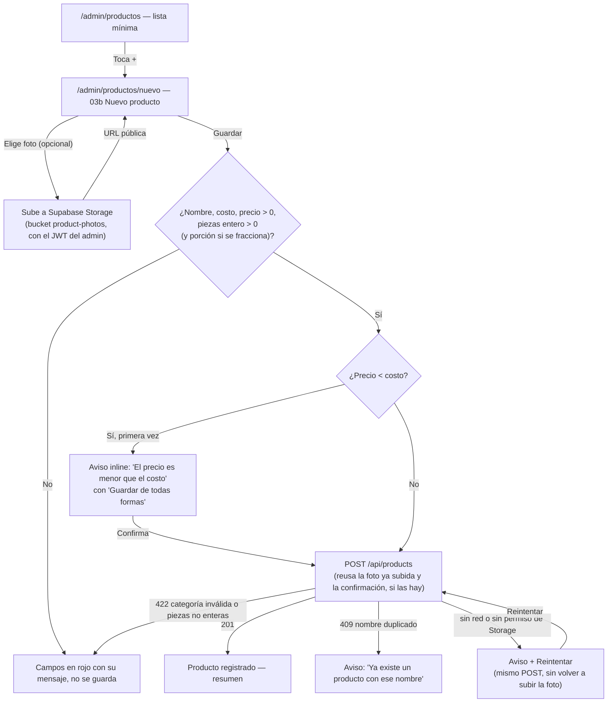

# Spec técnico — HU-04 · Dar de alta un producto nuevo

> **Estado:** Aprobado
> **Depende de:** M1-t03-tablas-productos-stock (`specs/M1-t03-tablas-productos-stock/spec.md`) — reusa `products` (con `fractionable`/`portionSize`), `stock_movements` (tipo `initial`, `holderProfileId`) y el bucket `product-photos`
> **Fecha:** 2026-10-25
> **Objetivo:** que el administrador dé de alta un producto nuevo desde «Productos» (foto opcional, nombre, categoría, costo, precio y piezas que entran), quede guardado con su primer movimiento de stock, y deje de capturarse en el Excel.

Fuentes: historia `SCRUM-21 · HU-04` del proyecto Jira `MammutSuplements` (espacio `SCRUM`), épica `SCRUM-6 · M1 · Productos y bodega`, páginas de Confluence «Requerimientos» (RF-03, RF-06) y «Mockups y flujo de pantallas · MVP v1» (pantallas 03, 03b y «Producto registrado»), specs previos `specs/M1-t03-tablas-productos-stock/spec.md` (esquema de `products`/`stock_movements`/bucket) y `specs/M0-base/spec.md` (convenciones de `AuthService`, guards y formularios con estado), y una revisión de este spec hecha el 2026-10-25 contra el código real del repo, que encontró dos huecos que este documento ya incorpora (ver §9, decisiones marcadas «a partir del hallazgo de la revisión»).

## 1. Objetivo y alcance

`SCRUM-21` solo pide «dar de alta» (7 criterios de aceptación): ni la pantalla 03 completa (cards, etiquetas de baja existencia, botones Vender/Dejar a vendedor) ni editar/buscar productos (parte de RF-03, pero fuera de los criterios de esta historia) están en su alcance. Esta sesión decidió, con el usuario, que para que el botón **+** del criterio 1 tenga dónde vivir, `/admin/productos` deja de ser `ComingSoonPageComponent` y pasa a ser una lista mínima (nombre, categoría, piezas), sin cards ni filtros; el diseño completo de la pantalla 03 queda para otra historia.

Una revisión posterior de este spec (ver §9) encontró que la migración de `M1-t03` solo hizo público el bucket `product-photos` para **lectura**, no para **escritura**: subir una foto con la llave anónima desde Angular fallaría por RLS. Este spec ya incorpora la corrección (una política de Storage que solo deja subir a un administrador autenticado), sin cambiar la decisión original de subir directo desde el frontend.

**Entra en este spec:**

- Backend: `GET /api/categories` (lista las categorías ya existentes en Supabase) y `GET /api/products` + `POST /api/products` (lista mínima y alta), con el movimiento de stock inicial dentro de la misma transacción que el `insert` del producto.
- Una migración SQL que agrega (a) un índice único case-insensitive sobre `products.name`, para que el criterio 5 se pueda rechazar de forma confiable y no solo con una consulta previa, y (b) una política de Storage que permite subir al bucket `product-photos` solo a un usuario autenticado con `profiles.role = 'admin'` y activo.
- Frontend: carpeta nueva `src/app/productos/` (`services/`, `interfaces/`) con el cliente HTTP hacia esos endpoints y el cliente de Supabase Storage para la foto, que manda el token de sesión del administrador (no la llave anónima a secas) para que la política de arriba lo autorice.
- Frontend: página `pages/productos-page` (lista mínima + botón **+**) en `/admin/productos`, y página `pages/nuevo-producto-page` (formulario 03b, con el estado final «Producto registrado») en `/admin/productos/nuevo`.
- Las 7 reglas de validación y aviso del propio `SCRUM-21`: campos obligatorios, piezas como entero, porción condicional, nombre duplicado, precio menor que el costo (con confirmación) y sin conexión (con reintentar sin perder lo escrito ni volver a subir la foto).

**No entra en este spec (queda para otras historias):**

- La pantalla 03 completa: cards con foto/piezas/precio/etiquetas, reparto B·L·A, y los botones **Vender** y **Dejar a vendedor** (pantalla 03a).
- Editar o buscar productos (parte de RF-03, pero ningún criterio de `SCRUM-21` lo pide).
- Importar el inventario desde Excel (RF-05, `Won't (v1)`).
- Precio y costo con envío por vendedor (RF-26/RF-27, `vendor_stock`) — son de `HU-05` (M2 según el propio `SCRUM-21`).
- Fraccionar (`HU-07`, RF-14): el checkbox «Se fracciona en bolsitas» solo guarda `fractionable`/`portionSize`; no genera ningún movimiento `fraction_out`/`fraction_in`.
- Pantalla 11 «Entrada a bodega» (sumar piezas a un producto que ya existe, RF-06 fuera del alta): este spec solo cubre el movimiento `initial` que nace al crear el producto.
- Categorías: crear, editar o borrar categorías — se listan las que ya existen en Supabase; no hay pantalla para administrarlas.

## 2. Reglas de negocio

- **Piezas que entran = movimiento de stock, nunca un número suelto** (RNF-05): al guardar, se inserta una fila en `stock_movements` con `type = 'initial'`, `holderProfileId = null` (bodega), `qty` = piezas capturadas y `createdBy` = el administrador que lo registra, en la misma transacción que el `insert` de `products`. `products.stock` se escribe igual a esas piezas en el mismo `insert`.
- **Piezas obligatorias, entero y mayores a 0**: no se puede dar de alta un producto sin ningún movimiento de stock real. Debe ser un entero porque `stock_movements.qty` y `products.stock` son columnas `integer` de Postgres; un decimal se rechaza como error de validación (`422`), no como un error interno.
- **`categoryId` debe existir o ser nulo**: si se manda un id que no corresponde a ninguna categoría, se rechaza como `422` («La categoría no existe»), no como un error interno de llave foránea.
- **Nombre duplicado, sin distinguir mayúsculas ni espacios** (criterio 5): `"Creatina"`, `"creatina "` y `"CREATINA"` cuentan como el mismo nombre. Se refuerza con un índice único sobre `lower(trim(name))` en la base, no solo con una consulta previa, para que dos altas casi simultáneas no creen un duplicado. Se verificó con una consulta de solo lectura, el 2026-10-25, que hoy no existen nombres duplicados en la tabla real (ver §5 y §9).
- **Porción condicional** (criterio 4): si `fractionable = false`, el campo «Porción» no se muestra y `portionSize` se guarda `null`. Si `fractionable = true`, «Porción» es obligatorio y se guarda como texto libre (reusa la decisión ya tomada en `M1-t03-tablas-productos-stock` §8: la unidad varía por producto; este spec no la reabre).
- **Precio menor que el costo, no bloquea** (criterio 6): se muestra un aviso inline bajo el formulario (mismo patrón que el estado `offline` de `login-page`) con un botón «Guardar de todas formas»; al tocarlo, se reenvía el mismo `POST` sin pedir los datos de nuevo.
- **Reintentar no repite la subida de la foto ni pierde una confirmación ya dada**: si ya se subió una foto a Storage y/o ya se confirmó «Guardar de todas formas» antes de perder la conexión, el botón «Reintentar» del estado `offline` reusa esa URL y esa confirmación; no vuelve a pedir el archivo ni a mostrar el aviso de precio otra vez. Sin esto, el propio criterio 7 («no pierdo lo que ya escribí») quedaría incompleto para quien ya pasó por la foto o el aviso de precio.
- **Foto opcional**: si no hay foto, `products.image` se guarda `''` (el valor por defecto que ya tiene la columna) y la pantalla muestra un recuadro con la inicial del producto (reusa `initialsOf` de `shared/initials.ts`, el mismo helper del círculo de «Mi cuenta»).
- **Subir la foto exige sesión de administrador activa**: el cliente de Supabase en Angular manda el `Authorization: Bearer <mamut.accessToken>` al subir; la política de Storage (§5) revisa que ese token sea de un `profiles.role = 'admin'` activo antes de dejar escribir en `product-photos`. Sin sesión válida, la subida se rechaza con un error de permisos (se trata igual que el estado `offline`: aviso + Reintentar).
- **El vendedor nunca llega a este formulario**: ya cerrado por `roleGuard` (`specs/M0-hu03-rutas-por-rol/spec.md`) y por `requireRole(request, 'admin')` en los dos endpoints nuevos.

## 3. Diagrama



## 4. Endpoints

| Método y ruta | Archivo | Rol | Nuevo |
| --- | --- | --- | --- |
| `GET /api/categories` | `backend/app/api/categories/route.ts` | admin | Sí |
| `GET /api/products` | `backend/app/api/products/route.ts` | admin | Sí (lista mínima: `id`, `name`, `categoryId`, `stock`, `active`) |
| `POST /api/products` | `backend/app/api/products/route.ts` | admin | Sí |

**`POST /api/products`** — cuerpo:

```ts
{
  name: string;            // obligatorio, no vacío
  categoryId: number | null; // si no es null, debe existir en `categories`
  price: number;           // obligatorio, > 0
  unitCost: number;        // obligatorio, > 0 ("costo de fábrica")
  initialQty: number;      // obligatorio, entero, > 0 ("piezas que entran")
  fractionable: boolean;
  portionSize: string | null; // obligatorio si fractionable === true
  image: string | null;    // URL ya subida a product-photos; null = sin foto
}
```

Respuestas: `201` con el producto creado (`price`/`unitCost` llegan como texto, por ser columnas `numeric` de Postgres; `stock = initialQty`); `409 conflict` si ya existe un producto con ese nombre (sin distinguir mayúsculas/espacios); `422 validation` si falta o es inválido cualquier campo obligatorio, si `initialQty` no es un entero, si falta `portionSize` con `fractionable = true`, o si `categoryId` no corresponde a ninguna categoría existente.

## 5. Modelo de datos

**Migración nueva** (`supabase/migrations/<fecha>_products_name_unique_and_photo_upload_policy.sql`, mismo mecanismo manual que `M1-t03` §6):

```sql
-- Verificado por separado con una consulta de solo lectura (2026-10-25): hoy no hay
-- nombres duplicados en `products`, así que este índice no falla al crearse. Si en el
-- futuro una carga masiva (Excel, v2) o el sitio Vue hermano crean un nombre repetido
-- (p. ej. mismo nombre con distinto sabor/tamaño en `brand`/`size`/`flavor`), esta
-- migración ya no se podría re-aplicar hasta resolver el duplicado a mano (ver §10).
create unique index products_name_lower_key on products (lower(trim(name)));

-- El bucket `product-photos` ya era público para LECTURA desde M1-t03, pero sin esta
-- política nadie podía subir (ni con la llave anónima): la política de "insert" faltaba.
-- Solo deja subir a un usuario autenticado con profiles.role = 'admin' y activo.
create policy "product_photos_admin_insert" on storage.objects
  for insert
  to authenticated
  with check (
    bucket_id = 'product-photos'
    and exists (
      select 1 from profiles
      where profiles.id = auth.uid() and profiles.role = 'admin' and profiles.active
    )
  );
```

Después de aplicarla, `npm run db:pull` en `backend/` regenera `schema.ts` (solo refleja el índice nuevo; las políticas de Storage no son parte del esquema de Drizzle). Se aplican los dos fixups manuales ya documentados en `CLAUDE.md` si vuelven a aparecer, y se borran los archivos de migración de Drizzle igual que en `M1-t03`.

No se agrega ninguna tabla ni columna: se reusa `products`, `categories` y `stock_movements` tal como quedaron en `specs/M1-t03-tablas-productos-stock/spec.md`.

**Backend — `backend/src/categories/categories.ts` (nuevo):**

```ts
export function listCategories() {
  return db.select().from(categories).orderBy(asc(categories.sortOrder), asc(categories.name));
}
```

**Backend — `backend/src/products/products.ts` (nuevo):**

```ts
export interface CreateProductInput {
  name: string;
  categoryId: number | null;
  price: number;
  unitCost: number;
  initialQty: number;
  fractionable: boolean;
  portionSize: string | null;
  image: string | null;
}

// Inserta el producto y su movimiento `initial` en una sola transacción. Traduce la
// violación del índice único de nombre a 409, y la violación de la FK de categoryId a 422
// (en vez de dejar que cualquiera de las dos llegue como 500).
export async function createProduct(input: CreateProductInput, createdBy: string) { /* ... */ }

export function listProducts() {
  return db.select({ id: products.id, name: products.name, categoryId: products.categoryId, stock: products.stock, active: products.active }).from(products).orderBy(asc(products.name));
}
```

**Backend — `backend/src/lib/handler.ts` (agrega un helper):**

```ts
// Campo numérico obligatorio. `min` es exclusivo (el valor debe ser > min, default 0);
// `integer: true` además rechaza decimales (422 en ambos casos).
export function requireNumber(
  body: Record<string, unknown>,
  field: string,
  opts: { min?: number; integer?: boolean } = {},
): number { /* ... */ }
```

**Frontend — `src/app/productos/interfaces/producto.models.ts` (nuevo):**

```ts
export interface Categoria {
  id: number;
  name: string;
  slug: string;
}

export interface NuevoProductoInput {
  name: string;
  categoryId: number | null;
  price: number;
  unitCost: number;
  initialQty: number;
  fractionable: boolean;
  portionSize: string | null;
  image: string | null;
}

export interface Producto {
  id: number;
  name: string;
  categoryId: number | null;
  price: string;      // numeric de Postgres: llega como texto; se convierte con Number() solo para mostrarlo
  unitCost: string;
  stock: number;
  fractionable: boolean;
  portionSize: string | null;
  image: string;
  active: boolean;
}
```

**Frontend — estado de `nuevo-producto-page` (mismo patrón de `signal` que `login-page`, extendido):**

```ts
type NuevoProductoState = 'form' | 'loading' | 'aviso-precio' | 'duplicado' | 'offline' | 'registrado';
// lastAttempt guarda los datos ya validados del formulario (igual que login-page);
// uploadedImageUrl y priceWarningConfirmed sobreviven a un Reintentar, para no volver a
// subir la foto ni a pedir la confirmación de precio otra vez.
```

**Frontend — `src/app/shared/supabase-config.ts` (nuevo, mismo patrón que `shared/api-base-url.ts`):**

```ts
// Llave anónima: es pública por diseño. Quien sube a `product-photos` manda además el JWT
// de sesión del administrador (ver §2); sin eso, la política de insert lo rechaza aunque
// tenga esta llave. La URL de producción queda fuera de este spec, igual que API_BASE_URL.
export const SUPABASE_URL = 'https://<proyecto>.supabase.co';
export const SUPABASE_ANON_KEY = '<anon-key>';
```

## 6. Plan de implementación

1. Crear y aplicar la migración (índice único + política de insert de Storage, §5); correr `db:pull` + fixups en `backend/`; verificar con `npm run type-check`.
2. Backend: agregar `requireNumber` (con soporte `integer`) a `src/lib/handler.ts`.
3. Backend: `src/categories/categories.ts` + `app/api/categories/route.ts` (`GET`, `requireRole(request, 'admin')`) + `tests/categories.test.ts`.
4. Backend: `src/products/products.ts` (`createProduct`, `listProducts`) + `app/api/products/route.ts` (`GET`, `POST`) + `tests/products.test.ts` (prefijo `test-prod-` + `Date.now()` en el nombre, igual patrón que `createTestClient`; limpia `stock_movements` antes que `products` por el FK `restrict`; casos: alta correcta con su movimiento `initial`, nombre duplicado sin distinguir mayúsculas, `categoryId` inexistente, `initialQty` decimal, piezas/costo/precio `<= 0`, `fractionable` sin `portionSize`, `categoryId` nulo permitido).
5. Frontend: agregar `@supabase/supabase-js` a `package.json`; crear `shared/supabase-config.ts` y `shared/supabase-client.ts` (instancia única de `createClient`).
6. Frontend: crear `src/app/productos/` con `services/productos.service.ts` (categorías, lista, alta vía HTTP) y `services/producto-fotos.service.ts` (sube a `product-photos` mandando el `Authorization: Bearer` del admin, devuelve la URL pública), más `interfaces/producto.models.ts`.
7. Frontend: `pages/nuevo-producto-page` (`ng generate component --style=none`) con los 6 estados de §5, reusando el patrón de `login-page` (foto ya subida y confirmación de precio sobreviven a Reintentar); agregar la ruta `admin/productos/nuevo` en `app.routes.ts` (hereda `RenderMode.Client` de `admin/**`, ya configurado).
8. Frontend: `pages/productos-page` (`ng generate component --style=none`) con la lista mínima (nombre + nombre de categoría, cruzando `GET /api/products` con `GET /api/categories` en el cliente, + piezas) y el botón **+** que enlaza a la ruta ya creada en el paso 7; reemplazar `ComingSoonPageComponent` por este componente en `admin/productos` dentro de `app.routes.ts`.
9. Pruebas unitarias del formulario (validación de campos, aviso de precio, duplicado, offline con reintentar sin perder lo escrito ni volver a subir la foto) y verificación manual end-to-end con `ng serve` + `npm run dev` del backend, contra los criterios de §7.

## 7. Criterios de aceptación

- [ ] Estando en «Productos», tocar **+** abre «Nuevo producto» con foto, nombre, categoría, costo, precio, piezas y la casilla «Se fracciona en bolsitas» (criterio 1 de `SCRUM-21`).
- [ ] Llenar nombre, categoría, costo, precio y piezas, y tocar «Guardar», lleva a «Producto registrado» con su resumen, y la bodega de ese producto queda con esas piezas (criterio 2).
- [ ] Dejar vacío el nombre, el costo o el precio, o escribir un número `<= 0`, marca el campo en rojo con su mensaje y no guarda nada (criterio 3).
- [ ] Sin marcar la casilla, «Porción» no aparece; marcándola, aparece y es obligatoria (criterio 4).
- [ ] Repetir el nombre de un producto ya existente (sin importar mayúsculas ni espacios) muestra «Ya existe un producto con ese nombre» y no crea un duplicado (criterio 5).
- [ ] Precio menor que el costo muestra el aviso «El precio es menor que el costo» y permite confirmar («Guardar de todas formas») o corregir (criterio 6).
- [ ] Sin conexión, muestra un aviso con «Reintentar»; al reintentar, no se pierde lo escrito ni se vuelve a subir la foto ni a pedir la confirmación de precio (criterio 7).
- [ ] Un `categoryId` que no existe responde `422` (no `500`) y no crea el producto.
- [ ] Las piezas que entran deben ser un número entero mayor a 0; un decimal responde `422`.
- [ ] Subir una foto sin una sesión de administrador válida es rechazado por la política de Storage, no silenciosamente aceptado.

## 8. Plan de pruebas

**Backend (`backend/`, Vitest contra la base real):**

- `categories.test.ts`: `GET /api/categories` responde `200` con la lista existente; `403` si no es admin.
- `products.test.ts`:
  - `POST /api/products` con datos válidos crea el producto, su `stock` queda igual a `initialQty`, y se inserta exactamente un `stock_movements` con `type = 'initial'`, `holderProfileId = null` y `qty = initialQty`.
  - Rechaza (`409`) un nombre que ya existe ignorando mayúsculas/espacios.
  - Rechaza (`422`) nombre vacío, `price <= 0`, `unitCost <= 0`, `initialQty <= 0`, `initialQty` decimal (p. ej. `2.5`), `categoryId` inexistente, y `fractionable = true` sin `portionSize`.
  - Acepta `categoryId: null`.
  - `403` si quien llama no es admin.
  - Todo lo creado lleva el prefijo `test-prod-`; el `afterAll`/`beforeAll` borra primero `stock_movements` y después `products` que empiecen con ese prefijo (el FK `restrict` exige ese orden).

**Frontend (`@angular/build:unit-test`):**

- `nuevo-producto-page.component.spec.ts`: campos vacíos/`<= 0` marcan error y no llaman al backend; `initialQty` con decimales marca error antes de llamar al backend; `fractionable` oculta/exige `Porción`; precio < costo muestra el aviso y «Guardar de todas formas» reenvía los mismos datos sin volver a subir la foto; `409` muestra el aviso de duplicado; sin red (`HttpErrorResponse` status 0) o sin permiso de Storage muestra «Reintentar» sin perder lo escrito ni la foto ya subida ni la confirmación de precio ya dada, igual patrón que `login-page.component.spec.ts`.
- `producto-fotos.service.spec.ts`: manda el `Authorization: Bearer` del admin y devuelve la URL pública tras subir el archivo.

**Manual (sin cuentas nuevas, con un admin de prueba ya existente):** los 7 pasos de §7, en orden, más confirmar que cancelar el formulario después de subir una foto no rompe nada (la foto queda huérfana, aceptado en §10) y que un `categoryId` borrado entre cargar el `<select>` y guardar muestra el error, no una pantalla rota.

## 9. Decisiones tomadas y descartadas

- **Sí:** página mínima para `/admin/productos` en vez de construir ya la pantalla 03 completa. Razón (decisión del usuario): `SCRUM-21` solo pide el alta; cards, etiquetas y los botones Vender/Dejar a vendedor son de otra historia.
- **Sí:** «Nuevo producto» es una ruta propia (`/admin/productos/nuevo`), no un modal. Razón (decisión del usuario): en el canvas de mockups, 03a se distingue como «(ventana)» y 03b no lleva esa etiqueta.
- **Sí:** categorías con `<select>` respaldado por `GET /api/categories`, en vez de texto libre. Razón (decisión del usuario): la tabla `categories` ya existe y ya es la FK de `products.categoryId` desde antes de `M1-t03`.
- **Sí:** piezas que entran, obligatorias y `> 0`. Razón (decisión del usuario): coincide con el objetivo de la historia («que la bodega lo cuente desde el primer día»).
- **Sí:** la foto se sube directo desde Angular a Supabase Storage, en vez de que el backend reciba el archivo. Razón (decisión del usuario, reconfirmada tras el hallazgo de la revisión): se mantiene la subida directa; lo que faltaba no era el enfoque, sino la política de escritura (siguiente punto).
- **Sí:** agregar una política de `insert` en `storage.objects` limitada a administradores autenticados (vía su JWT de sesión), en vez de pasar la foto por el backend. Razón (decisión del usuario, a partir del hallazgo de la revisión de este spec): la migración de `M1-t03` solo dejó el bucket público para lectura; esto corrige el permiso que faltaba sin reabrir la decisión de subir directo desde Angular.
- **Sí:** el aviso de «precio menor que el costo» es inline con un botón «Guardar de todas formas», no un modal. Razón (decisión del usuario): sigue el único precedente de aviso que ya existe en el repo (estado `offline` de `login-page`).
- **Sí:** el nombre duplicado se compara sin distinguir mayúsculas ni espacios, reforzado con un índice único sobre `lower(trim(name))`. Razón (decisión del usuario para la comparación; decisión técnica de esta sesión para reforzarla con un índice): una consulta previa sin índice deja una ventana de carrera entre dos altas casi simultáneas con el mismo nombre.
- **Sí:** verificar con una consulta de solo lectura, antes de proponer el índice único, que hoy no existen nombres duplicados en la tabla real. Razón (decisión técnica de esta sesión, a partir del hallazgo de la revisión): el índice fallaría al aplicarse si ya hubiera duplicados; se confirmó la base real (0 grupos duplicados, 2026-10-25) en vez de asumirlo.
- **Sí:** productos de prueba del backend con prefijo `test-prod-` y limpieza automática antes/después de cada suite, en vez de dejarlos `active = true` sin control. Razón (decisión del usuario, a partir del hallazgo de la revisión): `products` la lee el catálogo público del sitio Vue hermano; sin esto, cada `npm test` publicaría productos falsos ahí.
- **Sí:** `requireNumber` valida que `initialQty` sea entero, no solo `> 0`. Razón (decisión técnica de esta sesión, a partir del hallazgo de la revisión): `stock_movements.qty` y `products.stock` son columnas `integer`; un decimal debe rechazarse como `422` claro, no fallar como `500`.
- **Sí:** `createProduct` también captura la violación de la FK de `categoryId` y la traduce a `422`. Razón (decisión técnica de esta sesión, a partir del hallazgo de la revisión): sin esto, un `categoryId` inexistente respondería `500` en vez de un error de validación entendible.
- **Sí:** Reintentar y «Guardar de todas formas» reusan la foto ya subida y la confirmación ya dada. Razón (decisión técnica de esta sesión, a partir del hallazgo de la revisión): sin esto, el criterio 7 («no pierdo lo que ya escribí») quedaría incompleto para quien ya pasó por la foto o el aviso de precio antes de perder la conexión.
- **No:** reabrir la pregunta de «Porción: ¿gramos siempre, u otra unidad?» que `SCRUM-21` todavía lista como pendiente. Razón: ya se decidió en `specs/M1-t03-tablas-productos-stock/spec.md` §8 (texto libre); este spec solo reusa esa columna.
- **No:** agregar un endpoint o job para borrar fotos huérfanas (subidas a Storage pero el formulario nunca se guarda). Razón: las fotos son públicas y ligeras, y ahora solo un administrador autenticado puede subirlas (no cualquiera con la llave anónima); se acepta el riesgo en v1 (ver §10).

## 10. Riesgos

| Riesgo | Mitigación |
| --- | --- |
| Dos altas casi simultáneas con el mismo nombre (sin mayúsculas ni espacios) podrían pasar ambas si solo se valida con una consulta previa | Índice único `products_name_lower_key` sobre `lower(trim(name))` (§5); la segunda inserción falla a nivel de base y se traduce a `409` igual que `clients.ts` hace con `clients_name_key` |
| La migración del índice único falla si ya existe un nombre duplicado en la base real (p. ej. variantes del mismo nombre con distinto sabor/tamaño, cargadas desde el sitio Vue hermano o un futuro import de Excel) | Se verificó por solo lectura, el 2026-10-25, que hoy no hay ninguno (§5, §9); si vuelve a aparecer antes de aplicar esta migración, hay que resolverlo a mano (renombrar o fusionar) antes de reintentarla |
| Subir la foto a Storage y luego no guardar el formulario deja un archivo huérfano en `product-photos` | Aceptado para v1 (ver §9); solo un administrador autenticado puede subir (la política de §5 ya lo limita), así que no cualquiera puede llenar el bucket de fotos huérfanas |
| La llave anónima de Supabase queda visible en el bundle de Angular | Ya no basta con tenerla para subir fotos: la política de insert (§5) exige además un JWT de sesión de un `profiles.role = 'admin'` activo |
| Dos corridas de `products.test.ts` en paralelo podrían toparse con el índice único si usan el mismo nombre de prueba | Los nombres de prueba incluyen `Date.now()`, igual patrón que `createTestClient` en `tests/helpers/users.ts` |

## Lo que **no** entra en este spec

- La pantalla 03 completa (cards, etiquetas, Vender, Dejar a vendedor) — otra historia.
- Editar o buscar productos.
- Importar desde Excel (RF-05, v2).
- Precio y costo con envío por vendedor (RF-26/RF-27, `vendor_stock`) — `HU-05`.
- Fraccionar (RF-14) — `HU-07`.
- Entrada a bodega para un producto ya existente (pantalla 11).
- Administrar categorías (crear/editar/borrar).
- Limpiar fotos huérfanas en `product-photos` (aceptado como riesgo, ver §10).

Cada uno de estos, si se retoma, va en su propia historia o spec.
