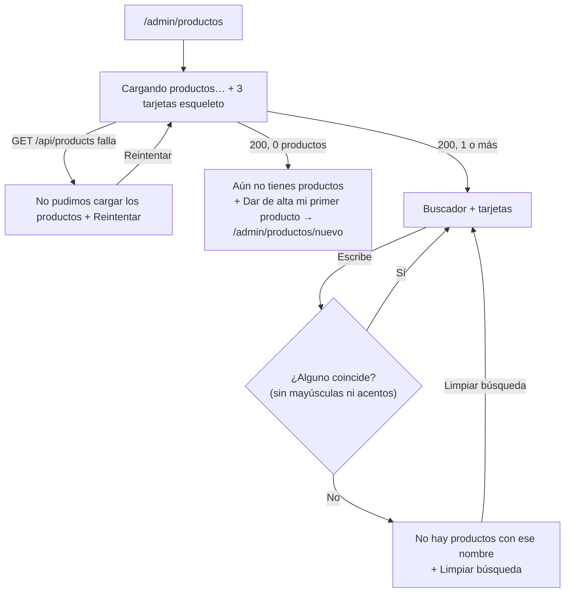

# Spec técnico — HU-05 · Ver y buscar mis productos

> **Estado:** Aprovado
> **Depende de:** M1-t03-tablas-productos-stock (`specs/M1-t03-tablas-productos-stock/spec.md`) — reusa `products` (`fractionable`, `parentProductId`); M1-hu04-dar-de-alta-producto (`specs/M1-hu04-dar-de-alta-producto/spec.md`) — reemplaza la lista mínima de `/admin/productos` y extiende `GET /api/products`
> **Fecha:** 2026-10-25
> **Objetivo:** que el administrador vea en «Productos» una tarjeta por producto (foto, nombre, piezas en bodega, precio y etiquetas) y la filtre por nombre mientras escribe, sin distinguir mayúsculas ni acentos.

Fuentes: historia `SCRUM-22 · HU-05` del proyecto Jira `MammutSuplements` (espacio `SCRUM`), épica `SCRUM-6 · M1 · Productos y bodega`; página de Confluence «Mockups y flujo de pantallas · MVP v1» y su canvas «Mammut Inventario MVP» (tableros `Productos.dc.html` — pantalla 03 — y `EstadosProductos.dc.html` — sus estados cargando, vacío y error); la carpeta `references/MammutSuplents/mammoth/` (catálogo Vue: `componentes/TarjetaProducto.vue`, `EsqueletoTarjeta.vue`, `BarraBusqueda.vue`, `EstadoVacio.vue`, `utilidades/imagenes.js`, `utilidades/formato.js`); los tokens de `src/styles.css` y los patrones visuales ya usados en `login-page`, `nuevo-producto-page` y `admin-page`; specs previos `specs/M1-hu04-dar-de-alta-producto/spec.md` y `specs/M1-t03-tablas-productos-stock/spec.md`; y una consulta de solo lectura a `products` del 2026-10-25 (1 producto, activo, sin foto, sin bolsitas).

## 1. Objetivo y alcance

`HU-04` dejó en `/admin/productos` una lista mínima (nombre, categoría, piezas) solo para que el botón **+** tuviera dónde vivir. Esta historia la reemplaza por las tarjetas de la pantalla 03, sin los botones **Vender** / **Dejar a vendedor** ni el reparto B · L · A (llegan en M2/M3), y le agrega el buscador y los estados cargando, vacío, sin resultados y error.

El canvas de mockups usa su propia paleta (pizarra y verde `#047857`). La app ya tiene la suya (crema y barro, `src/styles.css`). La **estructura** y los **textos** salen del mockup; los **colores, tipografía, radios y bordes** salen de los tokens y patrones que ya usa la app (ver §6).

**Entra en este spec:**

- Backend: `GET /api/products` agrega `price`, `fractionable` e `image` a su proyección, deja de devolver `active`, y solo lista productos con `active = true`. Sigue siendo solo para administrador y su proyección nunca incluye `unitCost`.
- Frontend: helper `shared/normalizar-texto.ts` (minúsculas y sin acentos) para comparar la búsqueda.
- Frontend: componente `pages/productos-page/ui/producto-card` (foto o inicial con etiquetas encima, nombre, piezas en bodega y precio).
- Frontend: componente `pages/productos-page/ui/producto-card-skeleton` (tarjeta de esqueleto para el estado cargando, como en el mockup y en `EsqueletoTarjeta.vue`).
- Frontend: `pages/productos-page` reescrita: lista de tarjetas en una columna, buscador que filtra en el cliente, y los estados cargando, error (con «Reintentar»), catálogo vacío y sin resultados.
- Los 6 criterios de aceptación del propio `SCRUM-22`.

**No entra en este spec (queda para otras historias):**

- Botones **Vender** (M3) y **Dejar a vendedor** (M2, pantalla 03a), el reparto B · L · A por vendedor (M2), el carrito y la barra «Viendo» que aparecen en el tablero `Productos.dc.html`.
- Etiqueta «Baja existencia» / «Quedan pocas» (M3, RF-17): falta decidir cuántas piezas es «bajo».
- Filtros por categoría o por fraccionado (RF-04): fuera de v1. Buscar por categoría tampoco entra (el placeholder del mockup dice «nombre o categoría»; el criterio 2 solo pide nombre).
- Búsqueda en el backend (`?q=`): se filtra en el cliente (ver §10).
- Convertir enlaces de Google Drive a imagen directa (`urlImagen` de `utilidades/imagenes.js`): hoy ningún producto tiene foto de Drive (ver §10).
- Ver, reactivar o editar productos inactivos, y editar productos en general.
- El catálogo del vendedor (pantallas 06 y 09) y cualquier endpoint de productos para el rol `vendedor`.
- Paginación o scroll infinito.

## 2. Reglas de negocio

- **Una tarjeta por producto activo**: la lista solo incluye `products.active = true`. Los productos que el sitio Vue hermano tenga desactivados no aparecen aquí.
- **Las bolsitas son productos como cualquier otro**: una fila con `parentProductId` no nulo se lista igual que las demás, sin filtro ni marca aparte (decisión de `M1-t03` §8: es una entidad vendible por sí misma).
- **Piezas en bodega = `products.stock`** (RF-09, solo bodega): es la caché que se recalcula con cada movimiento (`M1-t03` §2); esta historia solo la lee.
- **Etiquetas** (criterio 1): «Agotado» si `stock <= 0`; «Fraccionado» si `fractionable = true`. Si aplican las dos, se muestran las dos, apiladas sobre la foto, «Agotado» primero. Ninguna otra etiqueta entra en esta historia.
- **Precio de venta = `products.price`**, mostrado en pesos mexicanos (pipe `currency` con `'MXN'` y `'symbol-narrow'`, p. ej. «$450.00»). Llega como texto (columna `numeric`) y se convierte con `Number()` solo para mostrarlo, igual que en `HU-04`.
- **Sin foto** (`image = ''`), o si la imagen no carga: recuadro con la inicial del producto (`initialsOf` de `shared/initials.ts`, el mismo de `HU-04`). El catálogo Vue cae al logo en ese caso; aquí se mantiene la inicial que ya usa `HU-04` (ver §10).
- **Búsqueda por subcadena, sin distinguir mayúsculas ni acentos** (criterio 2): un producto coincide si `normalizarTexto(name)` contiene `normalizarTexto(búsqueda)`. `normalizarTexto` pasa a minúsculas, descompone con `normalize('NFD')`, quita las marcas diacríticas (mismo método que `slugificar` en `utilidades/formato.js` del catálogo Vue) y recorta espacios en los extremos. «cbum», «CBUM» y «Cbúm» encuentran «CBUM Thavage». Una búsqueda vacía (o solo espacios) muestra todos.
- **Se filtra mientras se escribe**, sin debounce ni llamada extra al backend: la lista completa se pide una sola vez al entrar a la pantalla (y otra vez con «Reintentar»).
- **Vacío ≠ sin resultados**: si el backend devuelve 0 productos, se muestra el estado vacío con el botón de alta, y el buscador no aparece (criterio 4). Si hay productos pero ninguno coincide, se muestra el estado sin resultados con «Limpiar búsqueda», que vacía el buscador (criterio 3).
- **Cualquier error al pedir la lista** (sin red o una respuesta 5xx) lleva al estado de error con «Reintentar», que vuelve a pedir la lista sin recargar la página (criterio 5). La sesión vencida la sigue manejando `authInterceptor`, igual que en el resto de la app.
- **El vendedor nunca recibe el costo de fábrica** (criterio 6, RNF-04): `GET /api/products` sigue con `requireRole(request, 'admin')` (el vendedor recibe `403` con el cuerpo de error estándar, sin productos), y además su proyección no incluye `unitCost` para nadie — la tarjeta del administrador tampoco lo muestra.

## 3. Diagrama



## 4. Endpoints

| Método y ruta | Archivo | Rol | Nuevo |
| --- | --- | --- | --- |
| `GET /api/products` | `backend/app/api/products/route.ts` | admin | No (cambia la proyección y filtra `active = true`) |

**`GET /api/products`** — respuesta `200`, ordenada por `name` ascendente:

```ts
Array<{
  id: number;
  name: string;
  categoryId: number | null;
  price: string;        // numeric de Postgres, llega como texto
  stock: number;        // piezas en bodega (caché de stock_movements)
  fractionable: boolean;
  image: string;        // '' = sin foto
}>
```

Sin `unitCost`, `portionSize` ni `active`. `401` sin token y `403` con token de vendedor, sin cambios respecto de `HU-04`. La ruta no cambia: solo cambia `listProducts` en `src/products/products.ts`.

## 5. Modelo de datos

Esta historia no agrega tablas, columnas ni migraciones. Reusa `products` tal como quedó en `specs/M1-t03-tablas-productos-stock/spec.md` y `specs/M1-hu04-dar-de-alta-producto/spec.md`.

**Backend — `backend/src/products/products.ts` (cambia `listProducts`):**

```ts
// Lista para la pantalla 03: solo productos activos, y nunca unitCost (RNF-04), aunque
// hoy el endpoint ya es solo para administrador.
export function listProducts() {
  return db
    .select({ id: products.id, name: products.name, categoryId: products.categoryId, price: products.price, stock: products.stock, fractionable: products.fractionable, image: products.image })
    .from(products)
    .where(eq(products.active, true))
    .orderBy(asc(products.name))
}
```

**Frontend — `src/app/productos/interfaces/producto.models.ts` (cambia):**

```ts
// Fila de GET /api/products (pantalla 03). Sin unitCost a propósito.
export interface ProductoResumen {
  id: number;
  name: string;
  categoryId: number | null;
  price: string;
  stock: number;
  fractionable: boolean;
  image: string;
}

// Fila completa que devuelve POST /api/products, para el resumen de "Producto registrado".
export interface Producto extends ProductoResumen {
  unitCost: string;
  portionSize: string | null;
  active: boolean;
}
```

**Frontend — `src/app/shared/normalizar-texto.ts` (nuevo):**

```ts
// Minúsculas, sin acentos ni diéresis y sin espacios en los extremos, para comparar
// búsquedas: "Cbúm " y "cbum" dan lo mismo. Se reusará en el catálogo del vendedor (06).
export function normalizarTexto(texto: string): string { /* ... */ }
```

**Frontend — estado de `productos-page`:**

```ts
type ProductosState = 'loading' | 'error' | 'ready';
// items: signal<ProductoResumen[]>, busqueda: signal<string>,
// visibles: computed (filtra items con normalizarTexto). 'ready' con items vacío = catálogo
// vacío; 'ready' con items llenos y visibles vacío = sin resultados.
```

**Frontend — `pages/productos-page/ui/producto-card` (nuevo):** recibe un `input.required<ProductoResumen>()` llamado `producto`; no emite eventos (no hay acciones en esta historia).

**Frontend — `pages/productos-page/ui/producto-card-skeleton` (nuevo):** sin entradas; solo marcado con `aria-hidden="true"`.

## 6. Diseño (mockup 03 traducido a los estilos de la app)

Estructura y textos del canvas (`Productos.dc.html`, `EstadosProductos.dc.html`); estilo con los tokens de `src/styles.css` y los patrones que ya usan `nuevo-producto-page` y `admin-page`. Ningún hex del mockup entra al código.

| Elemento del mockup | Valor del mockup | En la app |
| --- | --- | --- |
| Fondo de pantalla | `#EEF1F4` | `bg-page` (ya lo pone `admin-page`) |
| Superficie de tarjeta | blanco, borde `#D5DBE2`, radio 16px | `bg-white border border-line rounded-lg` (igual que el formulario de `nuevo-producto-page` y la lista de `HU-04`) |
| Texto principal / secundario | `#0F172A` / `#475569` | `text-ink` / `text-muted` |
| Acento (verde `#047857`, botón principal) | botón `min-height:48px`, radio 12px | `bg-accent text-white` / `hover:bg-accent-hover`, `min-h-12 rounded-lg font-bold` |
| Botón secundario («Reintentar») | blanco, borde `#B8C2CE` | `bg-white border border-line-strong text-ink rounded-lg font-bold` |
| Aviso de error | fondo `#FDECEC`, borde `#F1B0B0`, texto `#7F1D1D`, icono `#B91C1C` | `bg-danger-bg border-danger-border text-danger-text`, icono `text-danger` (mismo bloque `role="alert"` de `nuevo-producto-page`) |
| Etiqueta «Agotado» | fondo `#475569`, texto blanco | `bg-ink text-white` |
| Etiqueta «Fraccionado» | fondo `#DCF2E9`, texto `#065F46` | `bg-accent-2-bg text-accent-2-text` |
| Etiquetas (forma) | absolutas sobre la foto, 11px, bold, radio 4px | `absolute` arriba-izquierda de la foto, apiladas con `flex flex-col gap-1`, `text-[11px] font-bold rounded px-1.5 py-0.5` |
| Piezas en bodega | mono 22px bold + «en bodega» 12px | `font-mono text-[22px] font-bold` + `text-xs font-medium text-muted` «en bodega» |
| Precio | mono 14px bold | `font-mono text-sm font-bold` |
| Nombre | 14px bold | `text-sm font-bold leading-tight` |
| Esqueleto | bloques `#E2E7ED`, radio 6px | `bg-line animate-pulse rounded` (como `EsqueletoTarjeta.vue`) |
| Buscador | alto 46px, radio 12px, borde `#B8C2CE`, icono de lupa a la izquierda, `<label>` oculto | `h-[46px] rounded-lg border border-line-strong bg-white pl-11 text-base`, lupa SVG en línea con `text-muted` y `aria-hidden`, `<label class="sr-only">Buscar producto</label>` |
| Estado vacío / sin resultados | tarjeta blanca con borde punteado `#94A3B8`, radio 16px, icono de lupa, título 17px bold, texto 14px | `bg-white border border-dashed border-line-strong rounded-lg`, lupa SVG en `text-accent-2`, título `text-[17px] font-bold`, texto `text-sm text-muted` |
| Cargando | spinner + «Cargando productos…» + «Un momento.» + 3 esqueletos | igual, spinner SVG con `animate-spin` en `text-accent`, `role="status"` |

**Distribución de la tarjeta (decisión del usuario, se aparta del mockup):** el mockup usa una cuadrícula de 2 columnas con foto arriba; aquí es **una sola columna, tarjeta horizontal**: foto cuadrada (`h-24 w-24`, `object-cover`, `rounded-md`) a la izquierda con las etiquetas encima, y a la derecha nombre, piezas en bodega y precio. El espacio libre a la derecha queda para los botones **Vender** / **Dejar a vendedor** de M2/M3.

**Textos** (Jira manda donde el criterio da el texto; el mockup en lo demás):

- Encabezado: «Productos» (`font-display text-2xl font-extrabold`, como hoy) con el botón **+** a la derecha, sin cambios.
- Buscador: placeholder «Buscar por nombre».
- Cargando: «Cargando productos…» / «Un momento.» (mockup).
- Error: «No pudimos cargar los productos» / «Revisa tu conexión e inténtalo de nuevo.» + «Reintentar» (mockup).
- Vacío: «Aún no tienes productos» (criterio 4) / «Da de alta el primero para empezar a contarlo.» + botón «Dar de alta mi primer producto».
- Sin resultados: «No hay productos con ese nombre» (criterio 3) / «Revisa cómo lo escribiste.» + botón «Limpiar búsqueda».

## 7. Plan de implementación

1. Backend: cambiar `listProducts` en `src/products/products.ts` (proyección de §4 + `where active = true`); ampliar `tests/products.test.ts` con los casos de §9. Verificar con `npm run type-check` y `npx vitest run tests/products.test.ts`.
2. Frontend: actualizar `ProductoResumen`/`Producto` en `productos/interfaces/producto.models.ts` (§5) y ajustar lo que deje de compilar (`productos-page`, `nuevo-producto-page` y sus specs). La lista mínima actual sigue funcionando.
3. Frontend: crear `shared/normalizar-texto.ts` con `normalizar-texto.spec.ts`.
4. Frontend: `ng generate component pages/productos-page/ui/producto-card --style=none` con la tarjeta horizontal de §6 (foto con `loading="lazy"` y caída a la inicial en `(error)`; etiquetas apiladas sobre la foto; nombre, piezas en bodega y precio), con su spec.
5. Frontend: `ng generate component pages/productos-page/ui/producto-card-skeleton --style=none` con el esqueleto de §6 (mismo tamaño y distribución que la tarjeta).
6. Frontend: reescribir `pages/productos-page` con el estado de §5: quitar la llamada a `GET /api/categories` y `categoriaDe`; pintar `app-producto-card` por cada producto visible; estado cargando con 3 `app-producto-card-skeleton`; estado error con «Reintentar»; estado vacío con el botón hacia `/admin/productos/nuevo`. El botón **+** del encabezado se mantiene.
7. Frontend: agregar el buscador de §6 (solo cuando hay productos) atado a `busqueda`, el estado sin resultados con «Limpiar búsqueda», y actualizar `productos-page.component.spec.ts` con los casos de §9.
8. Verificación manual con `ng serve` + `npm run dev` del backend contra los criterios de §8, comparando cada estado lado a lado con los tableros `Productos.dc.html` / `EstadosProductos.dc.html` del canvas, con productos de prueba: uno con foto, uno sin foto, uno con 0 piezas, uno fraccionable y uno fraccionable con 0 piezas.

## 8. Criterios de aceptación

- [ ] Con productos registrados, «Productos» muestra una tarjeta por producto activo, en una columna, con foto (o su inicial), nombre, piezas en bodega, precio de venta en pesos, y las etiquetas «Agotado» (0 piezas) y «Fraccionado» (si se fracciona) sobre la foto cuando aplican; con ambas, aparecen las dos (criterio 1 de `SCRUM-22`).
- [ ] Un producto con `active = false` no aparece en la lista.
- [ ] Escribir parte del nombre (p. ej. «cbum», «CBUM», «cbúm») deja solo los productos que coinciden, sin importar mayúsculas ni acentos, mientras se escribe (criterio 2).
- [ ] Una búsqueda sin coincidencias muestra «No hay productos con ese nombre» y un botón «Limpiar búsqueda» que vacía el buscador y vuelve a mostrar todas las tarjetas (criterio 3).
- [ ] Sin productos activos, «Productos» muestra «Aún no tienes productos» y un botón que lleva a `/admin/productos/nuevo`, sin buscador (criterio 4).
- [ ] Mientras carga, se ve «Cargando productos…» con tarjetas esqueleto; si `GET /api/products` falla, se ve «No pudimos cargar los productos» con «Reintentar», y «Reintentar» vuelve a pedir la lista y la muestra si ya responde (criterio 5).
- [ ] Un vendedor que llama `GET /api/products` directo recibe `403` sin ningún dato de producto, y la respuesta del administrador tampoco incluye `unitCost` (criterio 6).
- [ ] Un producto con una URL de foto que no carga muestra su inicial en vez de una imagen rota.
- [ ] Ningún archivo nuevo o cambiado de `productos-page` tiene colores hex ni `.css` propio: todo usa los tokens de `src/styles.css` (§6).
- [ ] `npm test` (raíz) y `npm test` (`backend/`, con `SUPABASE_SERVICE_ROLE_KEY` configurada) pasan.

## 9. Plan de pruebas

**Backend (`backend/tests/products.test.ts`, Vitest contra la base real, mismo prefijo `test-prod-` y limpieza que `HU-04`):**

- El admin recibe `200` con un producto de prueba recién creado, con `price`, `stock`, `fractionable` e `image`, y sin las llaves `unitCost`, `portionSize` ni `active`.
- Un producto de prueba marcado `active = false` directo en la base no aparece en la respuesta.
- El vendedor recibe `403` y el cuerpo es `{ error: { code, message } }`, sin `unitCost` (amplía el caso «sin token da 401 y con token de vendedor da 403» que ya existe).

**Frontend (`@angular/build:unit-test`):**

- `normalizar-texto.spec.ts`: «Cbúm » → «cbum»; «Proteína Ñandú» → «proteina nandu»; cadena vacía → «».
- `producto-card.component.spec.ts`: muestra nombre, «$450.00» y «N en bodega»; «Agotado» solo con `stock = 0`; «Fraccionado» solo con `fractionable = true`; ambas con `stock = 0` y `fractionable = true`, «Agotado» primero; con `image = ''` muestra la inicial; un `error` de la imagen cambia a la inicial.
- `productos-page.component.spec.ts`: estado cargando con esqueletos; una tarjeta por producto; filtrar con «CBUM» y con «cbúm» deja solo el que coincide; sin coincidencias muestra el aviso y «Limpiar búsqueda» restaura la lista; respuesta vacía muestra «Aún no tienes productos» sin buscador; un error muestra «Reintentar» y al tocarlo se vuelve a llamar a `GET /api/products` y se pintan las tarjetas.

**Manual:** los pasos de §8 en el navegador con los productos de prueba del paso 8 de §7, apagando el backend para el estado de error, y comparando cada estado con su tablero del canvas.

## 10. Decisiones tomadas y descartadas

- **Sí:** filtrar la búsqueda en el cliente. Razón (decisión del usuario): el catálogo es de decenas o cientos de productos; la lista ya se pide entera para pintarla, así que filtrar en memoria responde al instante y no necesita otra llamada por tecla.
- **No:** búsqueda en el backend con `?q=` (`unaccent`/`ilike`). Razón: pediría debounce, una llamada por búsqueda y la extensión `unaccent` en Supabase, sin beneficio con este tamaño de catálogo. Si el catálogo crece mucho, va en su propio spec.
- **Sí:** `GET /api/products` sigue siendo solo para administrador, y su proyección nunca incluye `unitCost`. Razón (decisión del usuario): cumple el criterio 6 sin abrir el endpoint a un rol que todavía no tiene pantalla que lo use; el catálogo del vendedor (06/09) llega en M2 con su propio endpoint y su propia proyección.
- **No:** abrir `GET /api/products` al vendedor quitando `unitCost` según el rol. Razón: adelantaría trabajo de M2 sin pantalla que lo consuma.
- **Sí:** ocultar los productos con `active = false`. Razón (decisión del usuario): la tabla la comparte el sitio Vue; ver o reactivar inactivos llega cuando exista editar producto.
- **Sí:** las bolsitas aparecen como cualquier otro producto. Razón (decisión del usuario): son vendibles por sí mismas (`M1-t03` §8); hoy no existe ninguna.
- **Sí:** estructura y textos del canvas de mockups, pero colores, tipografía, radios y bordes de los tokens de la app. Razón (decisión del usuario): el canvas tiene su propia paleta (pizarra/verde) y la app ya fijó la suya en `src/styles.css`; la tabla de §6 es la traducción.
- **Sí:** una sola columna de tarjetas horizontales, aunque el mockup usa una cuadrícula de 2 columnas. Razón (decisión del usuario, reconfirmada después de ver el mockup): deja lugar para los botones **Vender** y **Dejar a vendedor** que llegan en M2/M3.
- **Sí:** con 0 piezas y fraccionable se muestran las dos etiquetas, apiladas, «Agotado» primero. Razón (decisión del usuario): el criterio 1 de Jira pide las dos; el mockup solo muestra una por tarjeta.
- **Sí:** cuando el criterio de Jira da un texto, manda Jira («Aún no tienes productos», «No hay productos con ese nombre»); en lo demás, el texto del mockup («Cargando productos…», «No pudimos cargar los productos»). Razón (decisión técnica de esta sesión): el tablero «Vacío» del mockup mezcla el caso vacío con el de sin resultados («No encontramos ese producto»), que Jira separa en dos criterios.
- **Sí:** estado cargando con tarjetas esqueleto en `ui/producto-card-skeleton`. Razón (decisión técnica de esta sesión): así lo dibuja el tablero «Cargando» y así lo hace `EsqueletoTarjeta.vue` del catálogo Vue; `CLAUDE.md` ya pone el esqueleto como ejemplo de subcomponente `ui/`.
- **Sí:** quitar la categoría de la tarjeta y la llamada a `GET /api/categories` de esta página. Razón (decisión del usuario): el criterio 1 no la pide; `categoryId` sigue en la respuesta para los filtros de v2 sin costo extra.
- **Sí:** la tarjeta vive en `pages/productos-page/ui/producto-card`. Razón (decisión del usuario): convención de `CLAUDE.md` para subcomponentes visuales de una página; la reusarán las acciones de M2/M3.
- **Sí:** `normalizarTexto` en `shared/`, no dentro de la página. Razón (decisión técnica de esta sesión): el catálogo del vendedor (06) va a necesitar la misma comparación.
- **Sí:** la imagen que no carga cae a la inicial, no al logo como en `utilidades/imagenes.js` del catálogo Vue. Razón (decisión técnica de esta sesión): `HU-04` ya muestra la inicial para «sin foto»; usar lo mismo para «foto rota» deja un solo reemplazo en toda la app.
- **No:** portar `urlImagen` (convertir enlaces de Google Drive). Razón (decisión técnica de esta sesión): la consulta de solo lectura del 2026-10-25 encontró 1 producto, sin foto, y ninguna URL de Drive; las fotos nuevas las sube `HU-04` a Supabase Storage. Si el sitio Vue llega a guardar enlaces de Drive en `products.image`, va en su propio spec.
- **No:** debounce en el buscador. Razón: el filtro es en memoria y no dispara llamadas; el aviso de «sin resultados» aparece en cuanto deja de haber coincidencias.

## 11. Riesgos

| Riesgo | Mitigación |
| --- | --- |
| `products.image` de productos cargados desde el sitio Vue podría traer enlaces de Google Drive o URLs que ya no existen | Caída a la inicial en `(error)` de la imagen (§7, paso 4); hoy no hay ninguno (consulta del 2026-10-25); si aparecen, portar `urlImagen` en su propio spec (§10) |
| El catálogo crece lo suficiente para que pedirlo entero sea lento | Hoy es 1 producto activo con 7 columnas; si deja de alcanzar, la búsqueda en el backend y la paginación van en su propio spec (§10) |
| Cambiar `ProductoResumen` rompe la compilación de `nuevo-producto-page` o sus pruebas | El paso 2 del plan actualiza las interfaces primero y deja todo compilando antes de tocar la pantalla |
| La traducción de colores del mockup a los tokens deja algún contraste por debajo de 4.5:1 (p. ej. texto `text-muted` sobre `bg-line` del esqueleto, o la etiqueta «Fraccionado») | Las combinaciones de §6 ya las usa la app en otras pantallas; la verificación manual del paso 8 revisa cada estado, y cualquier ajuste se hace con un token existente, no con un hex nuevo |

## Lo que **no** entra en este spec

- Botones **Vender** y **Dejar a vendedor**, reparto B · L · A, carrito y barra «Viendo» — M2/M3.
- Etiqueta «Baja existencia» / «Quedan pocas» — M3 (RF-17).
- Filtros o búsqueda por categoría o fraccionado (RF-04) — fuera de v1.
- Búsqueda en el backend y paginación.
- Convertir enlaces de Google Drive a imagen.
- Ver, reactivar o editar productos inactivos, y editar productos.
- Catálogo y endpoint de productos para el vendedor (06, 09) — M2.

Cada uno de estos, si se retoma, va en su propia historia o spec.
