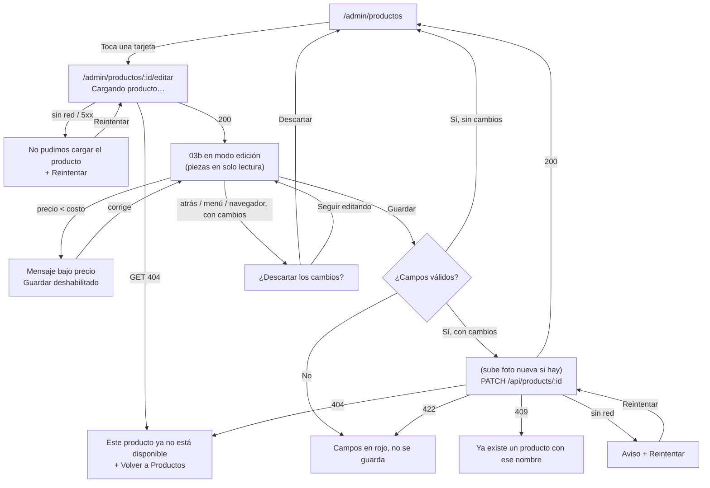

# Spec técnico — HU-06 · Editar los datos de un producto

> **Estado:** Implementado
> **Depende de:** M1-hu04-dar-de-alta-producto (`specs/M1-hu04-dar-de-alta-producto/spec.md`) — reusa `nuevo-producto-page`, `POST /api/products/photo` y el índice único de nombre; M1-hu05-ver-y-buscar-productos (`specs/M1-hu05-ver-y-buscar-productos/spec.md`) — la tarjeta `producto-card` pasa a ser el punto de entrada a la edición
> **Fecha:** 2026-10-26
> **Objetivo:** que el administrador toque un producto en «Productos», corrija su nombre, categoría, costo, precio, foto o porción en el mismo formulario del alta (sin poder tocar las piezas), y al guardar vea el cambio en la lista.

Fuentes: historia `SCRUM-23 · HU-06` del proyecto Jira `MammutSuplements` (espacio `SCRUM`), épica `SCRUM-6 · M1 · Productos y bodega` (pantalla «03b Nuevo producto (en modo edición)», RF-03); specs previos `specs/M1-hu04-dar-de-alta-producto/spec.md` y `specs/M1-hu05-ver-y-buscar-productos/spec.md`; el código actual de `nuevo-producto-page`, `productos-page/ui/producto-card`, `backend/src/products/products.ts` y el `alertdialog` de `account-page`; y una consulta de solo lectura a `products` del 2026-10-26 (1 producto, activo, 0 con `price < unit_cost`, 0 bolsitas).

## 1. Objetivo y alcance

`HU-04` dejó un formulario de alta (`/admin/productos/nuevo`) y `HU-05` la lista de tarjetas. Esta historia reusa el mismo formulario en **modo edición** en una ruta nueva, `/admin/productos/:id/editar`, a la que se llega tocando la tarjeta. El backend gana `GET` y `PATCH` sobre `/api/products/:id`.

Además, esta sesión decidió (con el usuario) una regla nueva que **cambia el alta de `HU-04`**: el precio de venta nunca puede quedar menor que el costo. En los dos modos, «Guardar» queda deshabilitado mientras eso pase, y el backend lo rechaza con `422` en `POST` y `PATCH`. Esto reemplaza el aviso «El precio es menor que el costo» + «Guardar de todas formas» del criterio 6 de `SCRUM-21` (ver §10).

**Entra en este spec:**

- Backend: `GET /api/products/:id` (producto completo para llenar el formulario, con `unitCost` y `portionSize`; solo admin; `404` si no existe o está inactivo).
- Backend: `PATCH /api/products/:id` (actualiza nombre, categoría, precio, costo, `fractionable`, porción y foto; nunca `stock`; `409` por nombre duplicado, `422` por validación, `404` si no existe o está inactivo).
- Backend: `price < unitCost` responde `422` tanto en `PATCH` como en `POST /api/products`.
- Frontend: `producto-card` se vuelve un enlace a `/admin/productos/:id/editar` (toda la tarjeta).
- Frontend: `nuevo-producto-page` con modo `alta` / `edicion` según la ruta: carga del producto, piezas en solo lectura con nota, foto actual con «Cambiar» y «Quitar», enlace «atrás» a «Productos», y al guardar regresa a «Productos».
- Frontend: regla «precio < costo» en vivo en los dos modos (mensaje bajo el precio + «Guardar» deshabilitado); se quita el estado `aviso-precio`.
- Frontend: guard `canDeactivate` + diálogo propio «¿Descartar los cambios?» cuando hay cambios sin guardar en modo edición, y `beforeunload` nativo para recargar/cerrar la pestaña.
- Los 5 criterios de aceptación de `SCRUM-23`.

**No entra en este spec (queda para otras historias):**

- Borrar un producto (fuera de v1 según `SCRUM-23`) y desactivar/reactivar productos, o editar productos inactivos.
- Cambiar las piezas: solo con movimientos (pantalla 11 «Entrada a bodega», otra historia).
- Bloquear el cambio de «Se fracciona» cuando el producto ya tenga bolsitas (`parentProductId`): llega con `HU-07` (hoy hay 0 bolsitas).
- Historial de cambios de precio/costo, o guardar precio y costo en ventas y cortes: la regla de Jira («cada venta guarda el precio y el costo del momento») se cumple cuando existan ventas (M3); esta historia solo la deja anotada.
- Borrar de Storage la foto anterior al cambiarla o quitarla (queda huérfana, igual que el riesgo ya aceptado en `HU-04`).
- Control de concurrencia (dos personas editando el mismo producto, o el sitio Vue hermano editándolo a la vez): gana el último que guarda.
- Preguntar «¿descartar?» en el modo alta: el criterio 5 es solo de edición.
- Menú de acciones al tocar la tarjeta, y los botones **Vender** / **Dejar a vendedor** (M2/M3).

## 2. Reglas de negocio

- **Entrada** (criterio 1): tocar cualquier parte de una tarjeta en «Productos» abre `/admin/productos/:id/editar` con el formulario lleno con los datos actuales del producto. No hay menú intermedio: hoy «Editar» sería su única opción.
- **Las piezas no se editan** (criterio 3): en modo edición, el campo «Piezas que entran» se reemplaza por un texto de solo lectura «N en bodega» con la nota «Las piezas solo cambian con movimientos, por ejemplo una entrada a bodega.». `PATCH` ignora y nunca escribe `stock`, y no inserta movimientos de stock.
- **Campos obligatorios iguales al alta** (criterio 4): nombre no vacío, costo `> 0`, precio `> 0`, y porción obligatoria si «Se fracciona» está marcado. El error se marca en el campo y no se manda nada al backend. La categoría puede quedar vacía (`null`).
- **Precio nunca menor que el costo** (regla nueva de esta sesión, alta y edición): si `precio < costo`, bajo el campo precio aparece en rojo «El precio no puede ser menor que el costo», en vivo mientras se escribe, y «Guardar» queda deshabilitado. Precio igual al costo sí se permite. El backend lo refuerza: `price < unitCost` → `422` («El precio no puede ser menor que el costo») en `POST` y `PATCH`.
- **Nombre duplicado** (igual que `HU-04`): el índice único `products_name_lower_key` ya lo cubre; `PATCH` traduce la violación a `409` «Ya existe un producto con ese nombre». Renombrar un producto a su mismo nombre con otras mayúsculas/espacios no choca consigo mismo (el índice compara contra las demás filas, y la fila que se actualiza es la misma).
- **«Se fracciona» es editable**: marcarlo exige porción; desmarcarlo oculta «Porción» y guarda `portionSize = null`, igual que el alta.
- **Foto**: se muestra la actual (o la inicial si no tiene). «Cambiar foto» elige otro archivo, que se sube con `POST /api/products/photo` al guardar (mismo flujo que `HU-04`, incluido no volver a subirla tras un Reintentar). «Quitar foto» deja `image = ''`. La foto anterior no se borra de Storage.
- **Solo productos activos**: `GET` y `PATCH` sobre un producto inexistente o con `active = false` responden `404`. La lista de `HU-05` ya solo muestra activos.
- **Guardar sin cambios**: si los valores del formulario son iguales a los cargados y no se eligió foto nueva ni se quitó la actual, «Guardar» regresa a «Productos» sin llamar al backend.
- **Guardar con éxito** (criterio 2): regresa a `/admin/productos`, que vuelve a pedir la lista (así lo hace `productos-page` al entrar) y muestra el precio nuevo. Sin pantalla de resumen.
- **Descartar cambios** (criterio 5): con cambios sin guardar en modo edición, cualquier navegación fuera de la pantalla (enlace «atrás», botón atrás del navegador, menú de `top-nav`) abre un `alertdialog` «¿Descartar los cambios?» con «Descartar» (sigue la navegación) y «Seguir editando» (la cancela). Recargar o cerrar la pestaña usa el aviso nativo de `beforeunload`. Sin cambios, o después de guardar con éxito, no pregunta.
- **«Hay cambios»** = algún campo difiere de lo cargado (nombre y porción comparados con `trim()`, números con `Number()`), o se eligió foto nueva, o se quitó la foto.
- **Sin conexión al guardar** (igual que `HU-04`): aviso con «Reintentar» que repite el mismo `PATCH` sin perder lo escrito ni volver a subir la foto.
- **Cambiar precio o costo no toca el pasado** (regla de `SCRUM-23`): hoy no hay ventas ni cortes; cuando existan (M3), cada venta guardará su propio precio y costo, así que `PATCH` solo cambia `products`.

## 3. Diagrama



## 4. Endpoints

| Método y ruta | Archivo | Rol | Nuevo |
| --- | --- | --- | --- |
| `GET /api/products/:id` | `backend/app/api/products/[id]/route.ts` | admin | Sí |
| `PATCH /api/products/:id` | `backend/app/api/products/[id]/route.ts` | admin | Sí |
| `POST /api/products` | `backend/app/api/products/route.ts` | admin | No (agrega `422` si `price < unitCost`) |

**`GET /api/products/:id`** — `200` con el producto completo (mismo formato que la respuesta `201` de `POST /api/products`, `Producto` en el frontend): `id`, `name`, `categoryId`, `price`, `unitCost`, `stock`, `fractionable`, `portionSize`, `image`, `active`. `404` si no existe o `active = false`; `422` si `:id` no es un entero (`parseId`); `401`/`403` como el resto.

**`PATCH /api/products/:id`** — cuerpo (todos obligatorios; el formulario siempre manda el estado completo):

```ts
{
  name: string;               // no vacío
  categoryId: number | null;  // si no es null, debe existir
  price: number;              // > 0 y >= unitCost
  unitCost: number;           // > 0
  fractionable: boolean;
  portionSize: string | null; // obligatorio si fractionable === true
  image: string;              // URL de product-photos, o '' para quitar la foto
}
```

Cualquier `stock`/`initialQty` que venga en el cuerpo se ignora. Respuestas: `200` con el producto actualizado (mismo formato que `GET`); `404` si no existe o está inactivo; `409` por nombre duplicado; `422` por campo faltante o inválido, `categoryId` inexistente, `fractionable` sin `portionSize`, o `price < unitCost`.

## 5. Modelo de datos

Esta historia no agrega tablas, columnas ni migraciones. Reusa `products` y el índice `products_name_lower_key` tal como quedaron en `specs/M1-hu04-dar-de-alta-producto/spec.md`.

**Backend — `backend/src/products/products.ts` (agrega):**

```ts
export interface UpdateProductInput {
  name: string
  categoryId: number | null
  price: number
  unitCost: number
  fractionable: boolean
  portionSize: string | null
  image: string
}

const PRICE_BELOW_COST = 'El precio no puede ser menor que el costo'

// Producto completo para el formulario de edición (incluye unitCost: solo admin). 404 si no
// existe o está inactivo, igual que la lista de HU-05 que solo muestra activos.
export async function getProduct(id: number) { /* ... */ }

// Actualiza los campos editables; nunca `stock` (las piezas solo cambian con movimientos,
// criterio 3 de HU-06). 404 si no existe o está inactivo; 409/422 igual que createProduct.
export async function updateProduct(id: number, input: UpdateProductInput) { /* ... */ }
```

`createProduct` agrega la misma validación `price < unitCost → validation(PRICE_BELOW_COST)` al inicio, junto a la de `portionSize`.

**Frontend — `src/app/productos/interfaces/producto.models.ts` (agrega):**

```ts
// Cuerpo de PATCH /api/products/:id. Sin piezas: solo cambian con movimientos.
export interface EditarProductoInput {
  name: string;
  categoryId: number | null;
  price: number;
  unitCost: number;
  fractionable: boolean;
  portionSize: string | null;
  image: string; // '' = sin foto
}
```

**Frontend — `src/app/productos/services/productos.service.ts` (agrega):** `obtener(id: number): Observable<Producto>` y `actualizar(id: number, input: EditarProductoInput): Observable<Producto>`.

**Frontend — estado de `nuevo-producto-page`:**

```ts
type Modo = 'alta' | 'edicion'; // de la ruta: con :id es edición
type NuevoProductoState =
  | 'cargando' | 'no-disponible' | 'error-carga'      // solo edición, al abrir
  | 'form' | 'loading' | 'duplicado' | 'offline'
  | 'registrado';                                     // solo alta
// Se quita 'aviso-precio' (y priceWarningConfirmed, confirmarPrecioMenorAlCosto, corregir).
// original: Producto | null (lo cargado, para «hay cambios»); quitarFoto: signal<boolean>;
// precio y costo como signals para el computed `precioMenorAlCosto`, que deshabilita Guardar.
```

**Frontend — `src/app/productos/guards/cambios-sin-guardar.guard.ts` (nuevo, carpeta `guards/` nueva):**

```ts
// canDeactivate genérico: si el componente dice que tiene cambios sin guardar, pide
// confirmación con su propio diálogo y devuelve la respuesta (Observable/Promise<boolean>).
export interface ConCambiosSinGuardar {
  tieneCambiosSinGuardar(): boolean;
  confirmarDescartar(): Promise<boolean>;
}
export const cambiosSinGuardarGuard: CanDeactivateFn<ConCambiosSinGuardar> = /* ... */;
```

**Frontend — rutas (`app.routes.ts`):** `{ path: 'productos/:id/editar', component: NuevoProductoPageComponent, canDeactivate: [cambiosSinGuardarGuard], data: { title: 'Editar producto' } }`, junto a `productos/nuevo`. Hereda `RenderMode.Client` de `admin/**`.

## 6. Diseño

Misma pantalla 03b de `HU-04`, con los tokens de `src/styles.css`; ningún hex nuevo ni `.css` propio.

- **Encabezado:** enlace «‹ Productos» arriba (`text-sm font-bold text-muted`, área táctil `min-h-11`) seguido del título «Editar producto» (`font-display text-2xl font-extrabold`, como «Nuevo producto»). El enlace «atrás» solo aparece en edición.
- **Tarjeta (`producto-card`):** el contenedor pasa a ser un `<a [routerLink]>` con `aria-label="Editar {{ nombre }}"`, `hover:border-line-strong`, `focus-visible:outline` con el token de acento, y `transition-colors`. Sin cambios visuales en reposo.
- **Piezas (solo lectura):** `font-mono text-[22px] font-bold` «N» + `text-xs text-muted` «en bodega» (igual que la tarjeta), y debajo la nota en `text-sm text-muted`.
- **Foto:** la vista previa actual (o la inicial, `initialsOf`) con dos botones secundarios «Cambiar foto» (abre el `input type="file"`) y «Quitar foto» (solo si hay foto actual o elegida); el estilo de botón secundario ya usado en `productos-page` («Reintentar»).
- **Precio < costo:** el mismo estilo de error de campo que ya usa el formulario (`border-danger` + mensaje `text-danger-text`, `aria-describedby`, clase de prueba `field-error`), en vivo. «Guardar» deshabilitado con `disabled:opacity-50 disabled:cursor-not-allowed`.
- **Cargando producto:** spinner `animate-spin text-accent` + «Cargando producto…», `role="status"` (como el estado cargando de `productos-page`).
- **No disponible / error de carga:** el bloque `role="alert"` ya usado (`bg-danger-bg border-danger-border text-danger-text`): «Este producto ya no está disponible» + «Volver a Productos»; «No pudimos cargar el producto» / «Revisa tu conexión e inténtalo de nuevo.» + «Reintentar».
- **Diálogo «¿Descartar los cambios?»:** mismo patrón `role="alertdialog"` que `account-page` (foco al abrir, `Escape` = «Seguir editando», foco de regreso al cerrar). Texto: «¿Descartar los cambios?» / «Lo que cambiaste no se va a guardar.»; botones «Seguir editando» (secundario) y «Descartar» (`bg-danger text-white`).

## 7. Plan de implementación

1. Backend: `createProduct` rechaza `price < unitCost` con `422`; ampliar `tests/products.test.ts` (POST con precio menor que el costo → `422`; precio igual al costo → `201`). Verificar con `npm run type-check` y `npx vitest run tests/products.test.ts`.
2. Backend: `getProduct` y `updateProduct` en `src/products/products.ts` + `app/api/products/[id]/route.ts` (`GET`, `PATCH`, `requireRole(request, 'admin')`, `parseId`) + `tests/products-id.test.ts` con los casos de §9.
3. Frontend: `EditarProductoInput` en `producto.models.ts`; `obtener`/`actualizar` en `productos.service.ts`.
4. Frontend: regla precio < costo en el alta: quitar `aviso-precio` y su lógica, agregar el `computed` y el mensaje en vivo, deshabilitar «Guardar»; actualizar `nuevo-producto-page.component.spec.ts` (los casos de «Guardar de todas formas» se reemplazan por los de §9). El alta sigue funcionando.
5. Frontend: modo edición en `nuevo-producto-page`: leer `:id` de la ruta, estados `cargando`/`no-disponible`/`error-carga`, llenar el formulario, piezas en solo lectura, foto con «Cambiar»/«Quitar», guardar con `PATCH` (o regresar sin llamar si no hay cambios) y navegar a `/admin/productos`; agregar la ruta `productos/:id/editar` en `app.routes.ts`.
6. Frontend: crear la carpeta `productos/guards/` y `cambios-sin-guardar.guard.ts` (con su spec); el diálogo «¿Descartar los cambios?» y `tieneCambiosSinGuardar`/`confirmarDescartar` en `nuevo-producto-page`; `@HostListener('window:beforeunload')` solo con cambios; enlace «‹ Productos»; registrar el guard en la ruta.
7. Frontend: `producto-card` como enlace a `/admin/productos/:id/editar` (§6); actualizar `producto-card.component.spec.ts`.
8. Verificación manual con `ng serve` + `npm run dev` contra los criterios de §8, con un producto de prueba con foto y otro fraccionable.

## 8. Criterios de aceptación

- [ ] En «Productos», tocar una tarjeta abre «Editar producto» con nombre, categoría, costo, precio, foto, «Se fracciona» y porción con sus valores actuales (criterio 1 de `SCRUM-23`).
- [ ] Cambiar el precio de venta y tocar «Guardar» regresa a «Productos» y la tarjeta muestra el precio nuevo (criterio 2).
- [ ] En «Editar producto» las piezas se ven como «N en bodega» con la nota de movimientos, sin campo editable, y un `PATCH` que manda `stock` no cambia las piezas (criterio 3).
- [ ] Dejar vacío el nombre, el costo, el precio o la porción (si se fracciona), o escribir un número `<= 0`, marca el error en el campo y no llama al backend (criterio 4).
- [ ] Con cambios sin guardar, tocar «‹ Productos», el botón atrás del navegador o un elemento del menú muestra «¿Descartar los cambios?»; «Seguir editando» se queda con lo escrito y «Descartar» sale sin guardar. Sin cambios, sale sin preguntar (criterio 5).
- [ ] En alta y en edición, con precio menor que el costo se ve «El precio no puede ser menor que el costo» bajo el precio y «Guardar» está deshabilitado; con precio igual al costo se puede guardar.
- [ ] `POST /api/products` y `PATCH /api/products/:id` con `price < unitCost` responden `422`.
- [ ] Renombrar a un nombre que ya usa otro producto muestra «Ya existe un producto con ese nombre» (`409`); renombrar a sí mismo con otras mayúsculas guarda bien.
- [ ] Cambiar la foto la sube y la tarjeta muestra la nueva; «Quitar foto» deja la tarjeta con la inicial.
- [ ] `GET`/`PATCH /api/products/:id` de un producto inactivo o inexistente responden `404`, y abrir su URL de edición muestra «Este producto ya no está disponible»; un vendedor recibe `403`.
- [ ] Ningún archivo nuevo o cambiado tiene colores hex ni `.css` propio.
- [ ] `npm test` (raíz) y `npm test` (`backend/`, con `SUPABASE_SERVICE_ROLE_KEY` configurada) pasan.

## 9. Plan de pruebas

**Backend (Vitest contra la base real, prefijo `test-prod-` y la misma limpieza que `HU-04`):**

- `products.test.ts` (amplía): `POST` con `price < unitCost` → `422` sin crear nada; `price === unitCost` → `201`.
- `products-id.test.ts` (nuevo):
  - `GET` como admin → `200` con `unitCost` y `portionSize`; inexistente → `404`; `active = false` → `404`; id no numérico → `422`; sin token → `401`; vendedor → `403`.
  - `PATCH` válido cambia nombre, categoría, precio, costo, porción e imagen y devuelve el producto actualizado; `stock` en el cuerpo no cambia `products.stock` y no se inserta ningún `stock_movements`.
  - `PATCH` `409` con el nombre de otro producto de prueba; `200` con su propio nombre en mayúsculas.
  - `PATCH` `422` con nombre vacío, `price`/`unitCost <= 0`, `price < unitCost`, `fractionable` sin `portionSize`, `categoryId` inexistente; `fractionable = false` guarda `portionSize = null`; `image = ''` quita la foto.
  - `PATCH` `404` para inexistente o inactivo; `403` para vendedor.

**Frontend (`@angular/build:unit-test`):**

- `nuevo-producto-page.component.spec.ts`:
  - Alta: precio < costo muestra el mensaje y deshabilita «Guardar»; precio = costo lo habilita; ya no existe «Guardar de todas formas».
  - Edición: muestra «Cargando producto…»; llena el formulario con `GET`; piezas como texto sin input; `404` muestra «Este producto ya no está disponible»; error de red muestra «Reintentar» y al tocarlo vuelve a llamar `obtener`.
  - Edición: guardar sin cambios navega a `/admin/productos` sin llamar `actualizar`; con cambio de precio llama `actualizar` con el cuerpo completo (sin piezas) y navega; `409` muestra el aviso de duplicado; sin red muestra «Reintentar» que repite el `PATCH` sin volver a subir la foto; «Quitar foto» manda `image: ''`; campos vacíos no llaman al backend.
  - Edición: `tieneCambiosSinGuardar()` es `false` recién cargado, `true` tras cambiar un campo o la foto, y `false` tras guardar; `confirmarDescartar()` abre el diálogo y resuelve `true`/`false` según el botón.
- `cambios-sin-guardar.guard.spec.ts`: sin cambios devuelve `true` sin preguntar; con cambios devuelve lo que resuelva `confirmarDescartar()`.
- `producto-card.component.spec.ts`: la tarjeta es un enlace a `/admin/productos/:id/editar` con `aria-label` «Editar …».

**Manual:** los criterios de §8 en el navegador, incluido el botón atrás del navegador y recargar la pestaña con cambios (aviso nativo), y apagar el backend al guardar para el estado sin conexión.

## 10. Decisiones tomadas y descartadas

- **Sí:** tocar toda la tarjeta abre la edición directamente. Razón (decisión del usuario): cubre «toco un producto y elijo Editar» sin un menú que hoy tendría una sola opción; Vender/Dejar a vendedor llegarán como botones propios en el espacio libre de la tarjeta.
- **No:** menú/hoja de acciones al tocar la tarjeta, ni botón «Editar» suelto. Razón: componente extra sin uso hasta M2/M3.
- **Sí:** reusar `nuevo-producto-page` en modo edición, en `/admin/productos/:id/editar`. Razón (decisión del usuario): Jira lo define como «03b en modo edición»; un solo formulario comparte validaciones, subida de foto, duplicado y sin conexión.
- **No:** una página `editar-producto-page` aparte. Razón: duplicaría toda la lógica del formulario.
- **Sí:** piezas en solo lectura con nota, no ocultas. Razón (decisión del usuario): responde al criterio 3 («cuando busco cómo cambiar las piezas») diciendo dónde se cambian.
- **Sí:** al guardar, regresar a «Productos» sin pantalla de resumen. Razón (decisión del usuario): el criterio 2 se verifica en la tarjeta.
- **Sí:** guardar sin cambios regresa sin llamar al backend. Razón (decisión del usuario): evita un `PATCH` inútil y se comporta como un guardado exitoso.
- **Sí:** `canDeactivate` + diálogo propio para «¿descartar?», cubriendo el enlace atrás, el navegador y el menú; `beforeunload` nativo para recargar/cerrar. Razón (decisión del usuario): una sola regla para cualquier salida y el mismo patrón visual que `account-page`.
- **No:** `window.confirm()`. Razón: se ve distinto al resto de la app.
- **Sí:** `GET` + `PATCH /api/products/:id`, con el cuerpo completo de campos editables. Razón (decisión del usuario): el formulario siempre tiene el estado completo; `GET` por id es necesario porque la lista (`HU-05`) no trae `unitCost` ni `portionSize`.
- **Sí:** «Se fracciona» editable. Razón (decisión del usuario): hoy hay 0 bolsitas (consulta del 2026-10-26); bloquearlo cuando existan es de `HU-07`.
- **Sí:** la foto se puede cambiar o quitar; la anterior queda en Storage. Razón (decisión del usuario): mismo riesgo de huérfanas ya aceptado en `HU-04`.
- **Sí:** precio menor que el costo bloquea «Guardar» en alta **y** edición, con mensaje en vivo, y el backend lo rechaza con `422` en `POST` y `PATCH`; precio igual al costo se permite. Razón (decisión del usuario): la regla es firme para el negocio; aplicarla en los dos modos evita que el alta cree productos que luego no se podrían guardar al editarlos.
- **No:** mantener el aviso «Guardar de todas formas» de `HU-04` (criterio 6 de `SCRUM-21`). Razón: lo reemplaza la regla anterior. Hay que dejar comentario en `SCRUM-21` de que su criterio 6 cambió por decisión tomada en `SCRUM-23`.
- **Sí:** verificar con una consulta de solo lectura que hoy no existe ningún producto con `price < unit_cost` (0 de 1, 2026-10-26). Razón (decisión técnica de esta sesión): si existiera, no se podría guardar al editarlo hasta corregir el precio.
- **Sí:** `GET`/`PATCH` dan `404` para productos inactivos. Razón (decisión técnica de esta sesión): coherente con `HU-05`, que oculta inactivos; editarlos llega con desactivar/reactivar.
- **Sí:** el guard `canDeactivate` vive en `productos/guards/`, genérico por interfaz. Razón (decisión técnica de esta sesión): convención de carpetas por funcionalidad de `CLAUDE.md`; la interfaz permite reusarlo en otros formularios.
- **No:** control de concurrencia (versión o `updated_at`). Razón: un solo administrador hoy; gana el último que guarda.

## 11. Riesgos

| Riesgo | Mitigación |
| --- | --- |
| El sitio Vue hermano (que comparte `products`) crea o edita productos con precio menor que el costo; al abrirlos aquí no se podrían guardar sin corregir el precio | Hoy hay 0 (consulta del 2026-10-26). El mensaje en vivo dice exactamente qué corregir; si aparecen muchos, se revisa en su propio spec |
| Quitar el estado `aviso-precio` rompe pruebas de `HU-04` | El paso 4 del plan reemplaza esos casos y deja el alta en verde antes de agregar el modo edición |
| El guard pregunta después de guardar con éxito, o no pregunta con el botón atrás del navegador | `tieneCambiosSinGuardar()` vuelve a `false` antes de navegar tras guardar; casos de prueba en §9 y verificación manual del botón atrás del navegador |
| El diálogo de `canDeactivate` y el `beforeunload` corren en SSR | La ruta hereda `RenderMode.Client` de `admin/**`; el `HostListener` de `window` solo se usa en el navegador |
| Reusar un componente para dos modos lo vuelve difícil de leer | Estados y ramas de cada modo separados por `modo()` en plantilla y en métodos (`guardarAlta` / `guardarEdicion`), con el comentario de cabecera actualizado |
| Fotos anteriores quedan huérfanas al cambiar o quitar la foto | Aceptado, igual que en `HU-04` |

## Lo que **no** entra en este spec

- Borrar, desactivar, reactivar o editar productos inactivos.
- Cambiar piezas (pantalla 11, entrada a bodega).
- Bloquear «Se fracciona» cuando haya bolsitas — `HU-07`.
- Precio y costo guardados en ventas y cortes — M3.
- Borrar fotos huérfanas de Storage.
- Control de concurrencia entre ediciones.
- Preguntar «¿descartar?» en el alta.
- Menú de acciones en la tarjeta, Vender y Dejar a vendedor — M2/M3.

Cada uno de estos, si se retoma, va en su propia historia o spec.
