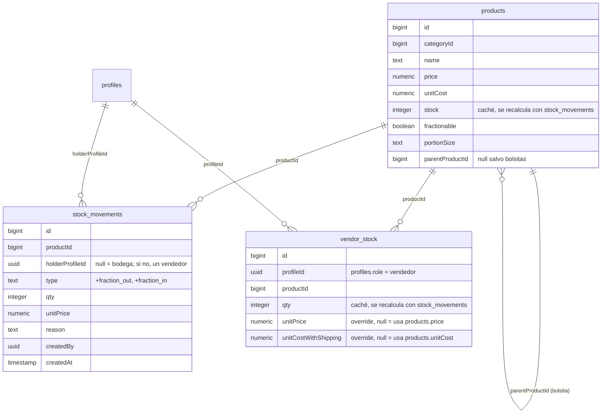

# Spec técnico — T-03 · Definir las tablas de productos y movimientos de stock

> **Estado:** Aprovado
> **Depende de:** M0-base (`specs/M0-base/spec.md`) — reusa `profiles.role = 'vendedor'`
> **Fecha:** 2026-10-24
> **Objetivo:** dejar el modelo de datos de productos y movimientos de stock listo en Supabase (tablas, columnas y una migración versionada en el repo) para que `HU-04`–`HU-07` de M1 puedan construirse encima sin tocar el esquema otra vez.

Fuentes: tarea `SCRUM-20 · T-03` del proyecto Jira `MammutSuplements` (espacio `SCRUM`), épica `SCRUM-6 · M1 · Productos y bodega`, página de Confluence "Problema y solución" (§8 Reglas del stock), "Requerimientos" (RF-03, RF-06 a RF-09, RF-14, RF-15, RF-26 a RF-30, RNF-05) y "Mockups y flujo de pantallas · MVP v1" (pantallas 02 a 05, 08 a 11), spec previo `specs/M0-base/spec.md` (§8, pregunta 4: vendedor vs. client), y `backend/src/db/schema.ts` tal como está hoy (tablas `products`, `clients`, `consignment_items`, `stock_movements` del backend reusado).

## 1. Objetivo y alcance

T-03 es trabajo técnico de M1: no hay pantalla ni historia de usuario que probar, solo el modelo de datos que las historias siguientes (`HU-04` Productos, `HU-05` Dejar/retirar, `HU-06` Vender, `HU-07` Fraccionar/merma) van a necesitar. Esta sesión resolvió, con el usuario, la pregunta abierta desde `specs/M0-base/spec.md` §8 (pregunta 4) y repetida en el propio `SCRUM-20`: **el "vendedor" de Mammut no es el mismo actor que el "client" (distribuidor en consignación) del backend reusado.** Se genera una entidad nueva en vez de reusar `clients`/`consignment_items`.

**Entra en este spec:**

- Extender la tabla `products` ya existente (es el mismo catálogo que usa el sitio Vue hermano) con las columnas que le faltan para Mammut: si se fracciona, su porción, y el enlace a su "bolsita" cuando se fracciona.
- Tabla nueva `vendor_stock`: cuánto tiene cada vendedor de cada producto, con su propio precio y costo con envío si se le puso uno (RF-26, RF-27).
- Extender `stock_movements` con una columna que diga de quién es el movimiento (bodega o un vendedor), en vez de la `client_id` que ya tiene (que queda intacta, sin usarse para Mammut).
- Dos tipos nuevos de movimiento (`fraction_out`, `fraction_in`) para el fraccionado; los tipos que ya existen (`purchase`, `delivery`, `return`, `direct_sale`, `shrinkage`, …) se reinterpretan como "de quién sea" en vez de "solo de bodega", usando la columna nueva.
- Un bucket público de Supabase Storage (`product-photos`) para las fotos de producto — `products.image` ya es un campo de texto, solo falta dónde vive el archivo.
- Una migración SQL versionada en `supabase/migrations/` en la raíz de `mamut-admin` (cierra la pregunta 1 de `specs/M0-base/spec.md` §8).

**No entra en este spec:**

- Ninguna pantalla, endpoint de API ni caso de uso (`src/accounts`-style) que use estas tablas — eso es de `HU-04` a `HU-07`.
- Nada del modelo de `clients`/`consignment_items`/`debtors`/`sales`/`cuts`/`shrinkage` del backend reusado: se dejan exactamente como están, sin tocarlas ni migrarlas. Si algún día un distribuidor mayorista real usa ese modelo, es un spec aparte.
- Filtros por categoría o por fraccionado (RF-04): `Should`, además explícitamente fuera de v1 según la página "MVP" de Confluence.
- Importar el inventario desde Excel (RF-05): `Won't (v1)`, confirmado otra vez en esta sesión — los productos se siguen capturando uno por uno.
- El endpoint o flujo para subir una foto al bucket `product-photos`: este spec solo deja el bucket creado; quien construya la pantalla "03b Nuevo producto" (`HU-04`) decide cómo sube el archivo.

## 2. Reglas de negocio

- **Vendedor ≠ client:** un vendedor es un `profiles` con `role = 'vendedor'`; no tiene ni necesita una fila en `clients`. `clients` queda reservada para un eventual distribuidor mayorista en consignación, que esta app no usa todavía.
- **El stock de bodega y el de cada vendedor se calculan con movimientos, nunca se escriben a mano** (RNF-05): toda alta, baja o traspaso de piezas pasa por una fila nueva en `stock_movements`; ninguna ruta de la API permite poner `products.stock` o `vendor_stock.qty` directamente.
- **`products.stock` y `vendor_stock.qty` son una caché**, no la fuente de verdad: se recalculan dentro de la misma transacción que inserta el movimiento (patrón `withTransaction`/`lockRows` ya documentado en `CLAUDE.md`), para que "02 Stock general" los lea en menos de 1 minuto (RNF-01) sin sumar miles de filas en cada carga.
- **Un movimiento nunca se borra ni se edita** (RNF-05): un error se corrige con otro movimiento (p. ej. una entrada con piezas negativas, o un `return` que revierte un `delivery`).
- **Fraccionar crea o reusa un producto "bolsita"** ligado al producto entero (`parentProductId`): el producto entero no puede fraccionarse en más de una porción distinta a la vez — una porción por producto fraccionable.
- **Precio y costo con envío por vendedor son opcionales** (RF-26, RF-27): si `vendor_stock.unitPrice` / `unitCostWithShipping` son `NULL`, se usa `products.price` / `products.unitCost`. Aplican solo a las piezas de ese vendedor; el precio y costo general del producto no cambian.
- **El vendedor nunca ve costo ni ganancia** (RNF-04, ya aplicado en M0): ninguna de estas tablas cambia esa regla; lo que falta es que los endpoints de M1 la respeten cuando lean de aquí.

## 3. Diagrama



## 4. Endpoints

Ninguno nuevo. T-03 es solo esquema; los endpoints que lean/escriban estas tablas (`GET /api/products`, `POST /api/stock-movements`, etc.) se definen en las historias `HU-04`–`HU-07`.

## 5. Modelo de datos

**`products` (extendida):**

```ts
export const products = pgTable('products', {
  // ...columnas existentes (name, categoryId, price, unitCost, stock, image, benefits, usage, active, ...)
  fractionable: boolean().default(false).notNull(),
  portionSize: text('portion_size'), // p. ej. "30 g"; libre porque la unidad varía por producto
  parentProductId: bigint('parent_product_id', { mode: 'number' }), // null salvo que esta fila sea la "bolsita" de otro producto
}, (table) => [
  foreignKey({ columns: [table.parentProductId], foreignColumns: [table.id], name: 'products_parent_product_id_fkey' }).onDelete('restrict'),
  unique('products_parent_product_id_key').on(table.parentProductId), // una porción por producto fraccionable
  check('products_parent_not_self', sql`parent_product_id IS NULL OR parent_product_id <> id`),
]);
```

**`vendor_stock` (nueva):**

```ts
export const vendorStock = pgTable('vendor_stock', {
  id: bigint({ mode: 'number' }).primaryKey().generatedAlwaysAsIdentity(),
  profileId: uuid('profile_id').notNull(), // profiles.role = 'vendedor', invariante de aplicación, no de la base
  productId: bigint('product_id', { mode: 'number' }).notNull(),
  qty: integer().default(0).notNull(),
  unitPrice: numeric('unit_price', { precision: 10, scale: 2 }), // override RF-26; null = usa products.price
  unitCostWithShipping: numeric('unit_cost_with_shipping', { precision: 10, scale: 4 }), // override RF-27; null = usa products.unitCost
  updatedAt: timestamp('updated_at', { withTimezone: true, mode: 'string' }).defaultNow().notNull(),
}, (table) => [
  foreignKey({ columns: [table.profileId], foreignColumns: [profiles.id], name: 'vendor_stock_profile_id_fkey' }).onDelete('restrict'),
  foreignKey({ columns: [table.productId], foreignColumns: [products.id], name: 'vendor_stock_product_id_fkey' }).onDelete('restrict'),
  unique('vendor_stock_profile_product_key').on(table.profileId, table.productId),
  check('vendor_stock_qty_check', sql`qty >= 0`),
]);
```

**`stock_movements` (extendida):**

```ts
export const stockMovements = pgTable('stock_movements', {
  // ...columnas existentes (productId, clientId, qty, unitPrice, reason, createdBy, createdAt)
  holderProfileId: uuid('holder_profile_id'), // null = bodega; si no, profiles.id del vendedor dueño del movimiento
}, (table) => [
  // ...foreignKeys existentes
  foreignKey({ columns: [table.holderProfileId], foreignColumns: [profiles.id], name: 'stock_movements_holder_profile_id_fkey' }).onDelete('restrict'),
  check('stock_movements_type_check', sql`type = ANY (ARRAY[
    'initial','purchase','adjustment','delivery','return',
    'direct_sale','direct_sale_void','shrinkage','shrinkage_void',
    'fraction_out','fraction_in'
  ]::text[])`), // reemplaza el check actual; agrega fraction_out/fraction_in
]);
```

**Bucket de Storage:** `product-photos`, público, sin SQL en Drizzle (se crea con una fila en `storage.buckets` dentro de la misma migración).

## 6. Plan de implementación

1. Crear `supabase/migrations/<fecha>_mammut_products_and_stock.sql` en la raíz de `mamut-admin` con: las columnas nuevas de `products`, la tabla `vendor_stock`, la columna `holder_profile_id` en `stock_movements`, el `ALTER` del check de `type`, y el `INSERT` que crea el bucket `product-photos` como público.
2. Aplicar esa migración contra la base real (mismo mecanismo manual ya usado para `profiles_role_check`, documentado en `specs/M0-base/spec.md` §8) y confirmar en Supabase Studio que el bucket quedó público.
3. Correr `npm run db:pull` en `backend/` y aplicar los dos fixups manuales ya documentados en `CLAUDE.md` (defaults de string vacío, referencia a `auth.users`), más revisar que `parentProductId`/`holderProfileId` quedaron como columnas nulables.
4. Verificar con `npm run type-check` en `backend/` que el `schema.ts` regenerado compila.
5. Borrar los archivos de migración de Drizzle que `db:pull` genera (`src/db/0000_*.sql`, `src/db/meta/`) — no se usan, igual que en el resto del backend.

## 7. Plan de pruebas

No hay lógica de negocio todavía (sin casos de uso ni endpoints), así que no hay una suite de Vitest nueva que escribir en este spec. Verificación:

- `npm run type-check` (`backend/`) pasa con el `schema.ts` regenerado.
- `npm run db:check` (`backend/`) sigue respondiendo (confirma que la conexión y el esquema `public` siguen sanos tras la migración).
- Verificación manual en Supabase Studio: existen las columnas nuevas en `products` y `stock_movements`, existe la tabla `vendor_stock` con sus FKs y su `unique(profile_id, product_id)`, y el bucket `product-photos` aparece como público en Storage.
- Insertar a mano una fila de prueba en cada tabla nueva (un producto fraccionable + su bolsita, un `vendor_stock` con overrides nulos, un `stock_movement` con `holder_profile_id` no nulo) y confirmar que los checks y FKs rechazan los casos inválidos (p. ej. `qty` negativo en `vendor_stock`, o `type` fuera de la lista). Se borran al terminar.

## 8. Decisiones tomadas y descartadas

- **Sí:** reusar y extender `products` en vez de duplicar el catálogo. Razón (decisión del usuario): es el mismo proyecto de Supabase que ya usa el sitio Vue hermano; crear una tabla paralela obligaría a mantener dos catálogos sincronizados a mano.
- **No:** reusar `clients`/`consignment_items` para los vendedores. Razón (decisión del usuario, cierra la pregunta 4 de `specs/M0-base/spec.md` §8): aunque dejar/retirar/vender/merma calzan estructuralmente con delivery/return/soldQty/shrinkageQty, un vendedor es un empleado con `profiles.role`, no un distribuidor mayorista con crédito; forzar esa relación habría dejado el código leyendo "client" para describir algo que no lo es. Se generaliza `stock_movements` con `holderProfileId` y se crea `vendor_stock` en vez de `consignment_items`.
- **Sí:** `products.stock` y `vendor_stock.qty` como caché recalculada en transacción, no como suma al vuelo. Razón (decisión del usuario): RNF-01 exige ver el stock en menos de 1 minuto; sumar `stock_movements` en cada carga de "02 Stock general" no escala tan bien como mantener un número ya listo, siempre que se actualice en la misma transacción que el movimiento.
- **Sí:** la bolsita de un producto fraccionado es una fila nueva de `products` (`parentProductId`), no una conversión de unidades sobre la misma fila. Razón (decisión del usuario): la pantalla 05 le pone su propio costo y precio de venta a la bolsita, igual que a cualquier otro producto — necesita ser una entidad vendible por sí misma.
- **Sí:** bucket público `product-photos` en vez de URLs firmadas. Razón (decisión del usuario): las fotos de producto ya son públicas en el catálogo del sitio Vue; firmar URLs agregaría complejidad sin proteger nada sensible.
- **Sí:** agregar `unitPrice`/`unitCostWithShipping` a `vendor_stock` desde ahora, aunque el propio `SCRUM-20` no lo pida explícitamente. Razón (decisión del usuario): evita una segunda migración chica cuando llegue la historia de "dejar a vendedor" (RF-26, RF-27 ya están confirmados para v1 en la página "MVP").
- **No:** crear tipos de movimiento separados para venta de vendedor (`vendor_sale`) o merma de vendedor. Razón: `direct_sale` y `shrinkage` ya describen el movimiento en sí; quién lo originó (bodega o un vendedor) ya lo dice `holderProfileId`, así que duplicar el tipo solo por el actor sería redundante.
- **Sí:** crear `supabase/migrations/` en la raíz de `mamut-admin`. Razón (decisión del usuario): coincide con la ruta relativa (`../supabase/migrations/`) que ya esperan `drizzle.config.ts` y el README del backend, sin tocar configuración.

## 9. Riesgos

| Riesgo | Mitigación |
| --- | --- |
| Dos transacciones concurrentes insertando movimientos del mismo producto podrían pisarse al recalcular la caché (`products.stock` / `vendor_stock.qty`) | Usar `lockRows` (`select … for update`) sobre la fila de `products`/`vendor_stock` antes de leer y volver a escribir su cantidad, mismo patrón ya documentado en `CLAUDE.md` para casos transaccionales |
| `holderProfileId` no tiene forma de exigir a nivel de base que apunte a un perfil con `role = 'vendedor'` (una FK no valida el valor de otra columna) | Se documenta como invariante de aplicación: el caso de uso que inserte el movimiento valida el rol antes de escribir, igual que ya pasa con otras reglas no expresables en un `check` de una sola tabla |
| La migración toca `stock_movements`, una tabla que el backend reusado también usa para su modelo anterior (aunque esta app no lo use) | `holder_profile_id` se agrega como columna nueva y nullable; no se quita ni se renombra nada existente, así que cualquier fila o consulta vieja sigue funcionando igual |

## Lo que **no** entra en este spec

- Pantallas, endpoints o casos de uso que lean o escriban estas tablas — `HU-04` a `HU-07`.
- Cambios al modelo de `clients`, `consignment_items`, `debtors`, `sales`, `cuts`, `shrinkage`, `credit_payments` o `direct_sales`/`direct_sale_items` del backend reusado.
- Filtros por categoría o fraccionado (RF-04) e importar desde Excel (RF-05) — confirmados fuera de v1.
- El flujo de subida de fotos al bucket `product-photos` — solo se deja el bucket creado.

Cada uno de estos, si se retoma, va en su propia historia o spec.
