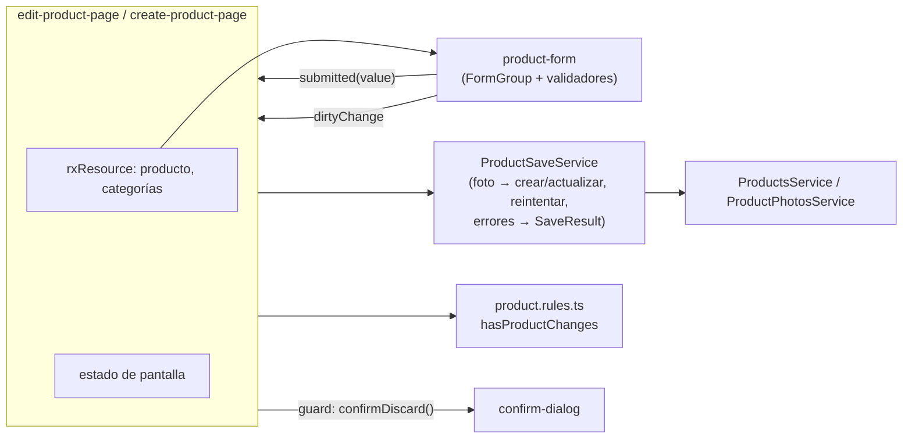

# Spec técnico — T-06 · Mover la lógica de negocio del frontend a servicios (SOLID)

> **Estado:** Borrador
> **Depende de:** M1-t05-codigo-en-ingles (`specs/M1-t05-codigo-en-ingles/spec.md`) — usa los nombres en inglés de su §4; M1-t04-angular-moderno (`specs/M1-t04-angular-moderno/spec.md`) — parte de `OnPush`, `rxResource`, `viewChild()` y rutas lazy
> **Fecha:** 2026-10-26
> **Objetivo:** que los componentes del frontend solo presenten datos y emitan eventos, con validaciones, reglas y orquestación de guardado en servicios y funciones del feature, sin cambiar nada de lo que ve o hace el usuario.

Fuentes: la sección «Buenas prácticas de código › Principios» de `CLAUDE.md`/`AGENTS.md` (agregada el 2026-10-26); tarea `SCRUM-27 · T-06` del proyecto Jira `MammutSuplements` (espacio `SCRUM`), épica `SCRUM-6 · M1 · Productos y bodega`; una revisión del código de la rama `spec-M1-hu06-editar-producto` del 2026-10-26; y los specs `M1-hu04`, `M1-hu05` y `M1-hu06`, cuyas reglas de negocio este spec reubica sin cambiarlas.

Los nombres de este spec son los de **después** de T-05 (tabla en `specs/M1-t05-codigo-en-ingles/spec.md` §4).

## 1. Por qué existe este spec

Es el último de los tres specs que aplican «Buenas prácticas de código» (orden: T-04 Angular → T-05 inglés → T-06 SOLID). La revisión del 2026-10-26 encontró la lógica de negocio concentrada en componentes:

| Dónde | Qué lógica tiene hoy |
| --- | --- |
| `product-form-page` (345 líneas, alta + edición) | Lee 7 inputs con `viewChild`; valida campos obligatorios, números `> 0`, piezas enteras, porción condicional y precio `>=` costo; decide «hay cambios» comparando contra el original; orquesta subir foto → crear/actualizar, recordando la URL subida para Reintentar; traduce `404`/`409`/`422`/sin red a estados; maneja un diálogo con foco, `Tab` atrapado y `Escape`; y el `beforeunload` |
| `account-page` | El mismo diálogo con foco copiado casi igual; la regla «si cerrar sesión falla, limpiar la sesión local igual» |
| `login-page` | Validación de campos vacíos, reintento con los últimos datos, `isOffline` (status 0) |
| `products-page` | El filtro de búsqueda (`normalizeText` + `includes`) dentro de un `computed` del componente |

`top-nav`, `admin-page`, `seller-page`, `coming-soon-page`, `product-card` y `product-card-skeleton` ya son presentacionales; no se tocan.

## 2. Alcance

**Entra en este spec:**

- **Formulario de producto partido en tres** (decisión del usuario):
  - `products/components/product-form` — presentacional: pinta el formulario (foto, nombre, categoría, costo, precio, piezas o «N en bodega», fracciona, porción), lleva el `FormGroup`, y emite eventos. No inyecta servicios de datos ni navega.
  - `pages/create-product-page` — `/admin/productos/nuevo`: carga categorías, usa `product-form` en modo alta, guarda y muestra «Producto registrado».
  - `pages/edit-product-page` — `/admin/productos/:id/editar`: carga producto y categorías, estados no disponible / error de carga, usa `product-form` en modo edición, guarda y regresa, y pregunta «¿Descartar los cambios?».
  - Se borra `pages/product-form-page`.
- **Reactive Forms** tipados con validadores propios en `products/validators/product-form.validators.ts`, incluido un validador de grupo «precio no menor que el costo» (decisión del usuario).
- **Reglas puras** en `products/rules/product.rules.ts`: `hasProductChanges` (lo que hoy es `hasUnsavedChanges`) y `filterProductsByName` (el filtro de `products-page`).
- **`products/services/product-save.service.ts`**: orquesta subir foto → crear o actualizar en una sola cadena, recuerda la URL ya subida para que Reintentar no vuelva a subirla, y traduce errores HTTP a un resultado tipado. Se provee por página (`providers` del componente), así su estado muere con la pantalla.
- **`shared/components/confirm-dialog`**: diálogo de confirmación con foco al abrir, `Tab` atrapado, `Escape` = cancelar y foco de regreso; lo usan `account-page` (cerrar sesión) y `edit-product-page` (descartar cambios).
- **`shared/http-errors.ts`**: `isOffline(error)` y `httpStatus(error)`, usados por `login-page`, `product-save.service` y donde haga falta distinguir sin red de un error del servidor.
- **`login-page`**: Reactive Forms para usuario y contraseña; Reintentar vuelve a mandar el valor del formulario (sin `lastAttempt` manual); `isOffline` desde `shared/http-errors.ts`.
- **`AuthService.logout()`**: absorbe la regla «si el backend falla, limpiar la sesión local igual», que hoy vive en `account-page`.
- **`products-page`**: usa `filterProductsByName`.
- Mover y ampliar pruebas: cada regla, validador y servicio con su propio spec; los specs de página quedan para el cableado.
- `CLAUDE.md`/`AGENTS.md`: agregar `validators/`, `rules/` y `components/` a la convención de carpetas por funcionalidad, y `confirm-dialog`/`http-errors.ts` a los ejemplos de `shared/`.

**No entra en este spec:**

- Cualquier cambio visible: textos, estilos, URLs, estados o comportamiento. Toda regla de `HU-04`, `HU-05` y `HU-06` se conserva tal cual.
- Backend.
- Reglas de dinero en centavos: hoy no hay cálculos de caja; la comparación precio/costo se mantiene con `Number()` y se revisa en M3 (igual que dijo `M1-t04`).
- Signal Forms (descartado, ver §8).
- Mover `unsavedChangesGuard` a `shared/`: hoy solo lo usa productos (convención de `CLAUDE.md`: `shared/` es para lo que usan varias funcionalidades).

## 3. Diseño

**Flujo de responsabilidades:**



**Reglas que cambian de casa (sin cambiar de contenido):**

| Regla (spec de origen) | Antes | Después |
| --- | --- | --- |
| Nombre, costo y precio obligatorios y `> 0`; piezas enteras `> 0` solo en alta; porción obligatoria si fracciona (HU-04 §2, HU-06 §2) | `onSubmit` de la página | Validadores en `product-form.validators.ts` + `FormGroup` de `product-form` |
| Precio nunca menor que el costo, mensaje en vivo y «Guardar» deshabilitado (HU-06 §2) | `computed` de la página | Validador de grupo `priceNotBelowCost`; `product-form` deshabilita «Guardar» si el grupo tiene ese error |
| Foco al primer campo inválido | `onSubmit` de la página | `product-form` (es presentación) |
| «Hay cambios» y «guardar sin cambios regresa sin llamar» (HU-06 §2) | `hasUnsavedChanges` de la página | `hasProductChanges(original, value)` en `product.rules.ts` |
| Reintentar no vuelve a subir la foto (HU-04 §2) | campos privados de la página | `ProductSaveService` |
| `409` → duplicado, `422` → categoría inexistente, `404` → no disponible, sin red → offline (HU-04, HU-06) | `handleSaveError` de la página | `ProductSaveService` → `SaveResult` |
| Diálogo con foco, `Tab` y `Escape` | copiado en dos páginas | `confirm-dialog` |
| Cerrar sesión limpia la sesión local aunque falle el backend (M0) | `account-page` | `AuthService.logout()` |
| Búsqueda sin mayúsculas ni acentos (HU-05 §2) | `computed` de `products-page` | `filterProductsByName` |

## 4. Modelo de datos

No agrega endpoints, tablas ni migraciones. Estructuras nuevas del frontend:

**`products/interfaces/product.models.ts` (agrega):**

```ts
// Valor que emite product-form al enviar. `units` solo existe en alta.
export interface ProductFormValue {
  name: string;
  categoryId: number | null;
  price: number;
  unitCost: number;
  units: number | null;
  fractionable: boolean;
  portionSize: string | null;
  photo: File | null;     // archivo nuevo elegido, si hay
  removePhoto: boolean;   // edición: quitar la foto actual
}

// Resultado de ProductSaveService: el componente decide qué pintar, no cómo leer HttpErrorResponse.
export type SaveResult =
  | { ok: true; product: Product }
  | { ok: false; reason: 'duplicate-name' | 'category-missing' | 'not-found' | 'offline' };
```

**`products/validators/product-form.validators.ts` (nuevo):**

```ts
export function positiveNumber(): ValidatorFn { /* ... */ }        // > 0
export function positiveInteger(): ValidatorFn { /* ... */ }       // entero > 0
// Porción obligatoria solo si `fractionable` está marcado.
export function portionRequiredWhenFractionable(): ValidatorFn { /* grupo */ }
// Precio >= costo (HU-06); error `priceBelowCost` en el grupo.
export function priceNotBelowCost(): ValidatorFn { /* grupo */ }
```

**`products/rules/product.rules.ts` (nuevo):**

```ts
// true si el valor del formulario difiere de lo cargado (nombre/porción con trim, números
// con Number, foto nueva o quitada). Regla de HU-06 §2.
export function hasProductChanges(original: Product, value: ProductFormValue): boolean { /* ... */ }

// Filtro de HU-05 §2: subcadena sobre normalizeText(name); búsqueda vacía = todos.
export function filterProductsByName(items: ProductSummary[], query: string): ProductSummary[] { /* ... */ }
```

**`products/services/product-save.service.ts` (nuevo, `@Injectable()` sin `providedIn`):**

```ts
@Injectable()
export class ProductSaveService {
  create(value: ProductFormValue): Observable<SaveResult> { /* ... */ }
  update(original: Product, value: ProductFormValue): Observable<SaveResult> { /* ... */ }
  // Reinicia la URL recordada, para «Dar de alta otro» sin recargar.
  reset(): void { /* ... */ }
}
```

**`products/components/product-form` (nuevo, `ng generate component products/components/product-form`):**

```ts
mode = input.required<'create' | 'edit'>();
categories = input<Category[]>([]);
initialValue = input<Product | null>(null);   // edición: llena el formulario y muestra «N en bodega»
busy = input(false);                          // deshabilita mientras guarda u offline
nameTaken = input(false);                     // 409: «Ya existe un producto con ese nombre»
categoryMissing = input(false);               // 422: aviso en categoría
submitted = output<ProductFormValue>();
dirtyChange = output<boolean>();
```

**`shared/components/confirm-dialog` (nuevo):**

```ts
title = input.required<string>();
message = input<string>('');
confirmLabel = input.required<string>();
cancelLabel = input.required<string>();
tone = input<'danger' | 'default'>('default');
confirmed = output<void>();
cancelled = output<void>();   // también con Escape
```

**`shared/http-errors.ts` (nuevo):**

```ts
// Sin respuesta real del servidor (red caída, CORS…): HttpErrorResponse con status 0.
export function isOffline(error: unknown): boolean { /* ... */ }
export function httpStatus(error: unknown): number | null { /* ... */ }
```

**Rutas (`admin.routes.ts`):** `productos/nuevo` → `CreateProductPageComponent`; `productos/:id/editar` → `EditProductPageComponent` con `canDeactivate: [unsavedChangesGuard]`. Mismas URLs y títulos.

## 5. Plan de implementación

Cada paso deja `ng build` y `npm test` en verde.

1. `shared/http-errors.ts` + spec; usarlo en `login-page` y en `product-form-page` (que aún existe).
2. `products/rules/product.rules.ts` + spec; `products-page` usa `filterProductsByName`.
3. `AuthService.logout()` absorbe la limpieza ante error + spec; `account-page` solo navega.
4. `shared/components/confirm-dialog` (`ng generate component`) + spec (foco, `Tab`, `Escape`, foco de regreso); reemplazar el diálogo de `account-page`.
5. `products/validators/product-form.validators.ts` + spec, y `ProductFormValue`/`SaveResult` en `product.models.ts`.
6. `products/services/product-save.service.ts` + spec (crear con y sin foto, actualizar con foto nueva / quitada / igual, Reintentar no vuelve a subir, mapeo de `404`/`409`/`422`/status 0).
7. `products/components/product-form` (`ng generate component`) + spec: mueve la plantilla del formulario de `product-form-page`, con Reactive Forms, validadores, foco al primer inválido, «Guardar» deshabilitado con `priceBelowCost`, foto (cambiar/quitar), y los eventos de §4.
8. `pages/create-product-page` (`ng generate component`) + spec: categorías con `rxResource`, `product-form` en alta, `ProductSaveService`, estados offline/Reintentar y «Producto registrado» con «Dar de alta otro». Cambiar la ruta `productos/nuevo`.
9. `pages/edit-product-page` (`ng generate component`) + spec: producto y categorías con `rxResource`, estados cargando / no disponible / error de carga, `product-form` en edición, guardar sin cambios regresa sin llamar (`hasProductChanges`), `confirm-dialog` para descartar, `HasUnsavedChanges` para el guard, `beforeunload` en `host`. Cambiar la ruta `productos/:id/editar`.
10. Borrar `pages/product-form-page` y su spec, después de comprobar que cada caso de su spec quedó cubierto en los specs de los pasos 5–9.
11. `login-page` con Reactive Forms; Reintentar reenvía el valor del formulario.
12. `CLAUDE.md`/`AGENTS.md` (§2). `specs/README.md`: relación con `M1-hu06` (ver §8).
13. Verificación: `ng build`, `npm test` y recorrido manual de §7.

## 6. Criterios de aceptación

- [ ] Ningún componente de `pages/`, `products/components/` ni `shared/components/` lee `HttpErrorResponse`, compara `status`, ni contiene validaciones o reglas de negocio: todo eso vive en `shared/http-errors.ts`, `products/validators/`, `products/rules/` o un servicio.
- [ ] `product-form` no inyecta `ProductsService`, `ProductPhotosService`, `ProductSaveService` ni `Router`; solo recibe `input()` y emite `output()`.
- [ ] `/admin/productos/nuevo` lo atiende `create-product-page` y `/admin/productos/:id/editar` lo atiende `edit-product-page`; `pages/product-form-page` ya no existe.
- [ ] Hay un solo diálogo de confirmación (`shared/components/confirm-dialog`), usado por «Cerrar sesión» y «¿Descartar los cambios?», con foco, `Tab` atrapado y `Escape` funcionando en ambos.
- [ ] `isOffline` existe solo en `shared/http-errors.ts`.
- [ ] Cerrar sesión con el backend apagado deja la sesión local limpia y lleva a `/login`, y esa regla vive en `AuthService`.
- [ ] Validadores, `hasProductChanges`, `filterProductsByName`, `ProductSaveService`, `isOffline`/`httpStatus` y `confirm-dialog` tienen cada uno su propio spec.
- [ ] Todos los criterios de aceptación de `M1-hu04`, `M1-hu05` y `M1-hu06` siguen cumpliéndose (recorrido manual de §7).
- [ ] `CLAUDE.md` y `AGENTS.md` describen `validators/`, `rules/` y `components/` dentro de una funcionalidad, y `confirm-dialog`/`http-errors.ts` en `shared/`.
- [ ] `ng build` y `npm test` (raíz) pasan.

## 7. Plan de pruebas

**Automático (`@angular/build:unit-test`):**

- `http-errors.spec.ts`: status 0 → offline; 409 → no offline y `httpStatus` 409; un error que no es HTTP → `null`.
- `product.rules.spec.ts`: `hasProductChanges` falso recién cargado y verdadero con cada campo, foto nueva y foto quitada; espacios y `"450"` vs `"450.00"` no cuentan como cambio. `filterProductsByName` con «cbum», «CBUM», «cbúm», vacío y solo espacios.
- `product-form.validators.spec.ts`: cada validador con valores válidos, vacíos, `0`, negativos y decimales; porción solo con fracciona; precio igual al costo válido, menor inválido.
- `product-save.service.spec.ts`: los casos del paso 6 de §5.
- `confirm-dialog.component.spec.ts`: foco inicial, `Tab`/`Shift+Tab` atrapados, `Escape` emite `cancelled`, botones emiten, foco de regreso.
- `product-form.component.spec.ts`: errores por campo y foco al primer inválido; «Guardar» deshabilitado con precio < costo; piezas como input en alta y como «N en bodega» en edición; cambiar/quitar foto se refleja en el valor emitido; `dirtyChange`.
- `create-product-page.component.spec.ts` y `edit-product-page.component.spec.ts`: los casos de página que hoy tiene `product-form-page.component.spec.ts` (estados, navegación, Reintentar, duplicado, no disponible, descartar), cableados con dobles de `ProductSaveService`.
- `auth.service.spec.ts`: `logout()` limpia la sesión aunque el backend responda error.
- `login-page` y `account-page`: sus specs actuales siguen pasando con los cambios de cableado.

**Manual (con `ng serve` + `npm run dev` del backend):** los criterios de aceptación de `M1-hu04`, `M1-hu05` y `M1-hu06` en el navegador, y login/cerrar sesión con el backend apagado.

## 8. Decisiones tomadas y descartadas

- **Sí:** `product-form` presentacional + dos páginas delgadas (`create-product-page`, `edit-product-page`). Razón (decisión del usuario): cumple «los componentes solo presentan datos y emiten eventos» y da una responsabilidad por página. **Revierte** la decisión de `M1-hu06` §10 de «una sola página con modo»; el formulario sigue siendo uno (ahora como componente), que era lo que esa decisión buscaba conservar.
- **No:** una sola página con modo y servicios aparte. Razón: la página seguiría conociendo los dos flujos.
- **Sí:** Reactive Forms tipados con validadores propios. Razón (decisión del usuario): patrón estable y estándar; quita la lectura manual de inputs con `viewChild` y deja las reglas en validadores que se prueban solos.
- **No:** Signal Forms. Razón: API más nueva y con menos ejemplos; se puede migrar después si se estabiliza.
- **No:** funciones puras sin librería de formularios. Razón: reinventaría estado de validación, `dirty` y errores por campo.
- **Sí:** `ProductSaveService` provisto por página, no `providedIn: 'root'`. Razón (decisión técnica de esta sesión): recuerda la URL de foto subida solo mientras dura la pantalla; con `root` sobreviviría entre altas.
- **Sí:** `SaveResult` tipado en vez de propagar `HttpErrorResponse`. Razón (decisión técnica de esta sesión): el componente decide qué pintar sin saber de HTTP.
- **Sí:** `confirm-dialog` y `http-errors.ts` en `shared/`. Razón (decisión del usuario): ya los usan dos funcionalidades (auth/cuenta y productos).
- **Sí:** alcance a todo el frontend (login, cuenta, lista), no solo productos. Razón (decisión del usuario): la regla aplica a todos los componentes.
- **Sí:** `AuthService.logout()` absorbe la limpieza ante error. Razón (decisión técnica de esta sesión): es una regla de sesión, no de la pantalla de cuenta.
- **Sí:** reglas puras en `products/rules/` y validadores en `products/validators/`, nuevas subcarpetas del feature. Razón (decisión técnica de esta sesión): se prueban sin Angular y siguen la convención de carpetas por funcionalidad; se documentan en `CLAUDE.md`.
- **No:** mover `unsavedChangesGuard` a `shared/`. Razón: hoy solo lo usa productos.
- **Sí:** tarea Jira `SCRUM-27 · T-06`. Razón (decisión del usuario): una tarea por spec.

## 9. Riesgos

| Riesgo | Mitigación |
| --- | --- |
| Al partir `product-form-page` se pierde algún caso que hoy prueba su spec (offline sin volver a subir la foto, duplicado, descartar, guardar sin cambios) | El paso 10 solo borra el spec viejo después de mapear cada caso a un spec nuevo; el recorrido manual repite los criterios de HU-04/05/06 |
| Reactive Forms cambia cuándo aparecen los errores (al tocar vs. al enviar) y altera lo que ve el usuario | `product-form` muestra errores de campo al enviar (como hoy) y solo `priceBelowCost` en vivo (como hoy); cubierto en su spec |
| El foco del diálogo compartido se comporta distinto en una de las dos pantallas | `confirm-dialog` tiene su propio spec de foco; el recorrido manual prueba cerrar sesión y descartar con teclado |
| `ProductSaveService` con estado compartido entre alta y edición si se provee mal | Se provee en `providers` de cada página; su spec prueba `reset()` |
| `dirtyChange` y `hasProductChanges` discrepan (el formulario se marca sucio al tocar sin cambiar el valor) | El guard usa `hasProductChanges` (compara valores), no el `dirty` de Angular; `dirtyChange` solo sirve para habilitar esa comparación |
